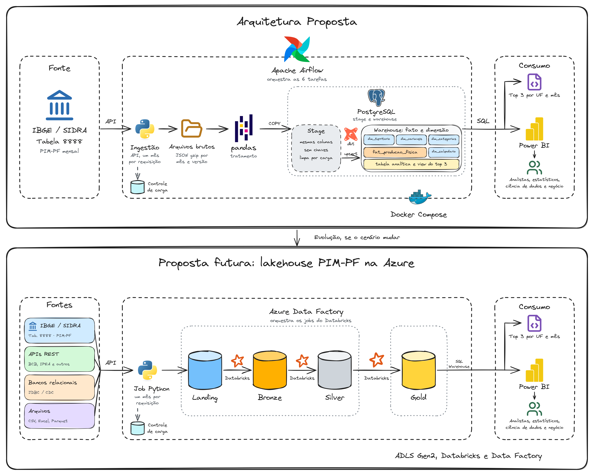
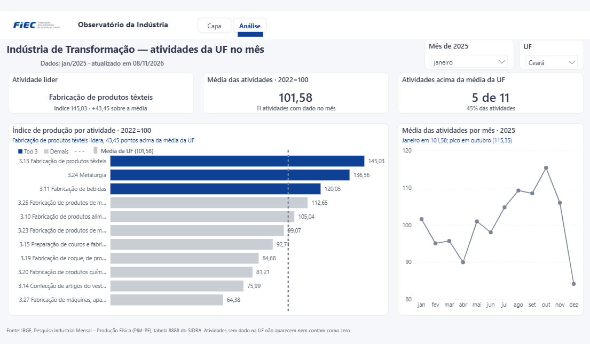

# Pipeline PIM-PF: do IBGE ao PostgreSQL e ao Power BI

Prova prática da seleção 7778 (Engenheiro de Dados II). O pipeline extrai a tabela 8888 do SIDRA por uma API própria, guarda as
respostas originais, trata os dados e publica um warehouse consultável via SQL, em Docker Compose e orquestrado pelo Airflow.



| Etapa | Ferramenta | Código |
|---|---|---|
| Ponto de entrada da ingestão | FastAPI | [src/pim_pf/api.py](src/pim_pf/api.py), [src/pim_pf/execucoes.py](src/pim_pf/execucoes.py) |
| Extração e arquivos brutos | Python e `requests` | [src/pim_pf/fonte.py](src/pim_pf/fonte.py), [src/pim_pf/extracao.py](src/pim_pf/extracao.py) |
| Tratamento e carga da Stage | pandas e `COPY` | [src/pim_pf/tratamento.py](src/pim_pf/tratamento.py), [src/pim_pf/carga.py](src/pim_pf/carga.py) |
| Da Stage ao warehouse, views e testes de dados | dbt | [dbt/](dbt/) |
| Orquestração | Airflow | [dags/pim_pf_8888.py](dags/pim_pf_8888.py), [src/pim_pf/cliente_api.py](src/pim_pf/cliente_api.py) |
| Consulta do top 3 | SQL | [sql/top3_por_uf_mes.sql](sql/top3_por_uf_mes.sql) |
| Painel | Power BI (PBIP) | [powerbi/](powerbi/) e [painel publicado](#como-abrir-o-painel) |

As decisões estão em [docs/arquitetura/ARQUITETURA.md](docs/arquitetura/ARQUITETURA.md).

## Como executar

É preciso ter o Docker com o Compose. A primeira carga também precisa de acesso à internet.

```bash
cp .env.example .env
docker compose up -d --build
```

O código fica dentro das imagens. Depois de alterar `dags/`, `src/` ou `dbt/`, repita o comando com `--build`.

Em seguida, abra <http://localhost:8080> e ative a DAG `pim_pf_8888`. Ao ser ativada, ela inicia a primeira carga sozinha, que lê os
297 meses da fonte e leva cerca de 4 minutos. Também é possível ativá-la pelo terminal:

```bash
docker compose exec airflow-scheduler airflow dags unpause pim_pf_8888
```

### Serviços e portas

Todas as portas só atendem à própria máquina (`127.0.0.1`). Altere-as no `.env` se estiverem em uso.

| Serviço | Porta | Variável | Finalidade |
|---|---|---|---|
| `airflow-apiserver` | 8080 | `AIRFLOW_PORTA` | Interface do Airflow |
| `ingestao` | 8000 | `INGESTAO_PORTA` | API de ingestão e sua documentação, em `/docs` |
| `postgres` | 5432 | `POSTGRES_PORTA` | Consultas SQL e Power BI |

`airflow-scheduler`, `airflow-dag-processor` e `airflow-init` não publicam portas. O serviço `dbt` confere a instalação e encerra: é o `DockerOperator` que
cria um contêiner a partir da mesma imagem em cada execução.

## Como consultar

O schema `warehouse` tem o fato `fat_producao_fisica`, as dimensões `dim_territorio`, `dim_variaveis`, `dim_categorias` e `dim_calendario`,
a tabela analítica `fato_producao_fisica_industrial_2025` (índice, média e diferença por UF, mês e atividade de 2025) e uma
única view, `vw_top3_transformacao_2025`, com as 3 atividades de maior índice por UF e mês, lida dessa tabela. A consulta
[sql/top3_por_uf_mes.sql](sql/top3_por_uf_mes.sql) lê essa view.

```bash
docker compose exec -T postgres psql -U pim -d pim < sql/top3_por_uf_mes.sql
```

## Como usar a API

```bash
# Extrai uma dimensão, sem baixar valores
curl -X POST http://localhost:8000/extracoes/variaveis -H "Content-Type: application/json" -d '{}'

# Extrai a produção física de um intervalo de até 24 meses. Carrega também as dimensões.
curl -X POST http://localhost:8000/extracoes/producao-fisica -H "Content-Type: application/json" \
  -d '{"inicio": "2025-01", "fim": "2025-03"}'

# Acompanha pelo identificador devolvido
curl http://localhost:8000/execucoes/<execucao_id>
```

A API carrega os dados na Stage. Para chegarem ao warehouse, é preciso rodar o dbt, como a DAG faz, ou `docker compose run --rm dbt dbt run`.
O contrato completo está em [contracts/api-ingestao.md](specs/001-pipeline-pim-pf/contracts/api-ingestao.md).

## Como reprocessar

Sem período informado, o modo `auto` consulta os meses ainda não extraídos, os 3 últimos publicados e os meses parciais. Por isso, a primeira carga traz todo o histórico.
Revisões da fonte em meses anteriores a essa janela só entram com o modo `completa`.

| `modo` | O que faz | Chama o IBGE? |
|---|---|---|
| `auto` (padrão) | Grava e carrega só os meses cujo conteúdo mudou | Sim |
| `completa` | Baixa todos os meses de novo e grava uma nova versão. Aceita códigos novos ou removidos na fonte. Não aceita intervalo | Sim |
| `reprocessar` | Refaz a Stage e o warehouse a partir dos arquivos já guardados | Não |

`inicio` e `fim` limitam os meses, no formato `AAAA-MM`, em até 24 meses.

```bash
docker compose exec airflow-scheduler airflow dags trigger pim_pf_8888 \
  --conf '{"modo": "reprocessar", "inicio": "2025-01", "fim": "2025-01"}'
```

Se um código de variável, categoria ou território mudar na fonte, a carga para com a causa `estrutura_alterada`. Depois de avaliar a mudança, aceite-a com o modo `completa`.

Não use `dbt run --full-refresh`: a Stage só contém os meses alterados, e o warehouse perderia os demais.

## Como testar

```bash
# Extração, tratamento e API, com a fonte simulada, mais a trava de execução no banco
docker compose run --rm ingestao pytest

# Testes do dbt, depois da carga
docker compose run --rm dbt dbt test
```

Na DAG, os testes do lote rodam em `dbt.validar_lote`, antes de publicar: se reprovarem, o warehouse não muda. Os demais rodam no grupo `dbt.warehouse`, criado pelo Cosmos: cada modelo tem uma tarefa `run` e, logo depois, uma `test` com os testes dele. Se um teste reprovar, a execução fica como falha, e a correção é reprocessar o período. A DAG agrupa as tarefas em `ingestao` e `dbt`.

O Cosmos desenha as tarefas a partir do `manifest.json`, gerado no build da imagem do Airflow. Depois de alterar o projeto dbt, refaça as imagens com `docker compose up -d --build`.

No Git Bash do Windows, defina `MSYS_NO_PATHCONV=1` antes de comandos que tenham caminhos do contêiner.

## Como abrir o painel

[](https://app.powerbi.com/groups/de98009a-bde0-4468-b154-2f9d17d352f7/reports/24fac210-7462-4c64-93d3-d82dca607eb1/analise?language=pt-BR&experience=power-bi)

Clique na imagem para abrir o [painel no Power BI](https://app.powerbi.com/groups/de98009a-bde0-4468-b154-2f9d17d352f7/reports/24fac210-7462-4c64-93d3-d82dca607eb1/analise?language=pt-BR&experience=power-bi), direto na tela de análise. O link abre o relatório no workspace e pede login na conta Microsoft.

O painel segue o [mockup](mockup/observatorio-mockup.html) aprovado. As decisões de cada visual estão no
[racional](mockup/observatorio-mockup-racional.md). O PBIP é gerado a partir desse desenho por `powerbi/ferramentas/gerar_pbip.py`.

Para abrir o painel local, ligado ao seu PostgreSQL:

1. Com a carga concluída, abra `powerbi/Observatorio.pbip` no Power BI Desktop.
2. Atualize os dados. Informe o usuário `pim_leitura` e a senha `PIM_LEITURA_SENHA` do `.env`, com autenticação de banco de dados.
3. Se o Desktop perguntar sobre criptografia, aceite a conexão sem ela: o PostgreSQL local não usa TLS.

Se a porta for diferente de 5432, ajuste o parâmetro `Porta` em Transformar dados. O painel lê só o schema `warehouse`, e esse usuário não enxerga os demais.

## Como atualizar um ambiente antigo

O nome dos schemas mudou, e eles só são criados com o volume vazio. Para migrar um ambiente anterior a essa mudança, recrie os volumes e refaça a carga:

```bash
docker compose down -v   # apaga os dados e os arquivos brutos deste projeto
docker compose up -d --build
```

## Como atualizar as dependências

As versões de todos os pacotes das imagens de ingestão e do dbt, inclusive os indiretos, estão travadas em
`requirements/ingestao.lock` e `requirements/dbt.lock`. Assim, cada build instala as versões que passaram nos testes. Para atualizar:

1. Altere a versão em `requirements/ingestao.txt` ou em `requirements/dbt.txt`.
2. Remova temporariamente o `-c` do Dockerfile correspondente em `docker/` e reconstrua a imagem.
3. Rode todos os testes. Se passarem, gere o `.lock` de novo com `docker compose run --rm --no-deps -T ingestao pip freeze` (ou `dbt`), mantendo o cabeçalho.
4. Volte com o `-c` e reconstrua com `--no-cache` para confirmar.

## Como parar

```bash
docker compose down      # mantém os dados
docker compose down -v   # apaga os dados e os arquivos brutos
```

## Limites do ambiente local

Estas escolhas valem para a avaliação, e não para a produção:

- A API não tem autenticação, e todo usuário do Airflow é administrador.
- O `airflow-scheduler` acessa o socket do Docker, o que dá controle sobre o Docker da máquina ([ADR 0012](docs/arquitetura/adr/0012-dbt-em-conteiner-e-socket-docker.md)).
- Os valores do `.env.example` são apenas de exemplo.
