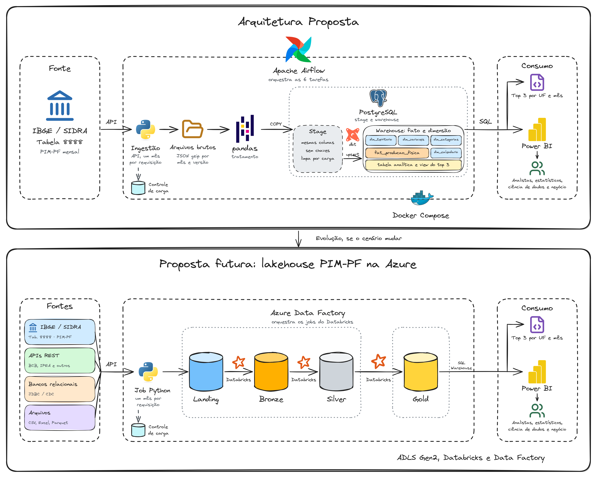
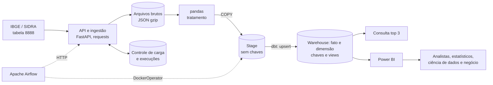
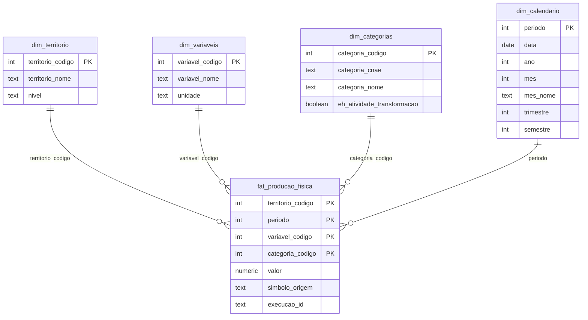
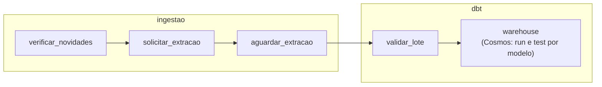

# Arquitetura: pipeline PIM-PF com API, pandas, dbt, Stage e warehouse em fato e dimensão



- Diagrama editável, com a arquitetura atual e a proposta futura: [arquitetura.excalidraw](arquitetura.excalidraw)
- Evolução prevista: [proposta futura com lakehouse em camadas](proposta-futura/PROPOSTA-FUTURA.md)
- Especificação, plano e contratos: [specs/001-pipeline-pim-pf/](../../specs/001-pipeline-pim-pf/spec.md)

## 1. Resumo

O Observatório da Indústria precisa disponibilizar a PIM-PF (tabela 8888 do IBGE) de forma confiável e responder a perguntas analíticas sobre a
Indústria de Transformação em 2025. Uma API aciona a extração com Python, que guarda os arquivos originais, trata com pandas e carrega uma Stage. O dbt, em
contêiner próprio, publica um warehouse de fato e dimensão no PostgreSQL, consumido por SQL e por um painel no Power BI. O Airflow orquestra tudo, em Docker Compose.
O pipeline foi executado do zero com os dados reais, inclusive em um clone limpo; os resultados estão na seção 6.

As decisões mais importantes:

1. **Stage e warehouse em fato e dimensão, com calendário e views analíticas**, adequados ao cenário atual de uma fonte e cerca de 914 mil linhas
   ([ADR 0008](adr/0008-stage-e-dw-estilo-oltp.md), [ADR 0010](adr/0010-dw-em-fato-e-dimensao.md) e [ADR 0013](adr/0013-nomes-do-warehouse.md)). O lakehouse em camadas fica como
   proposta futura ([ADR 0007](adr/0007-modelo-relacional-e-proposta-futura.md)).
2. **Detecção de mudanças por hash de cada mês**, porque a fonte só informa uma data para a tabela inteira. O mesmo mecanismo cobre mês novo, mês parcial e
   revisão ([ADR 0003](adr/0003-deteccao-de-mudancas-por-hash.md)).
3. **O símbolo `-` vira nulo, nunca zero**, e o símbolo original é preservado ([ADR 0004](adr/0004-simbolos-do-sidra.md)).
4. **API como ponto de entrada da ingestão** ([ADR 0011](adr/0011-api-de-ingestao.md)) e **dbt em contêiner acionado por `DockerOperator`**, com o risco do socket do Docker registrado ([ADR 0012](adr/0012-dbt-em-conteiner-e-socket-docker.md)).

## 2. Fatos da fonte e consequências

Detalhes e reprodução em [fonte-sidra-8888.md](../fonte-sidra-8888.md).

| Fato | Evidência | Consequência no desenho |
|---|---|---|
| Os 297 períodos têm a mesma data de modificação | Medido em `/periodos` | A data avisa que algo mudou, mas não o quê. Comparar hash por mês |
| 202609 tem números só para o Brasil | Medido em 2026-11-06 | "Mês existe" não significa "mês completo". O controle guarda o status |
| `-` em 59% das atividades de 2025, sempre nos mesmos pares UF × atividade | Medido: 2.892 de 4.896 linhas; 167 pares presentes nos 12 meses | Nulo, com símbolo preservado |
| `...` aparece em meses parciais | Medido em 202609 e 200201 | Distinguir os símbolos; não usar conversão genérica sem verificação |
| Agregado "3 Indústrias de transformação" na mesma dimensão | Medido | Marcar atividades pelo padrão `3.NN` |
| A atividade 3.20 usa o código 56689, fora da sequência | Medido nos metadados | Nunca filtrar por faixa de códigos |
| 19 territórios: Brasil, Nordeste e 17 UFs | Medido | A view filtra o nível UF; a validação espera 17 |
| 914.166 linhas | Medido na carga completa: 3.078 × 297 | Um banco relacional atende bem; não há necessidade de lake nem de Spark |
| pandas trata esse volume com pico de 343 MB | Medido com uma competência real repetida 297 vezes | Tratamento na ingestão, sem serviço adicional |
| Chaves únicas em 2025: território, mês, variável e categoria | Medido: 36.936 linhas sem duplicidade | Serve como chave primária e base do upsert |
| Todos os períodos juntos retornam HTTP 400, mas 24 meses funcionam | Medido: 73.872 linhas em 5,5 s | Um parâmetro de até 24 meses é viável. A extração segue mês a mês para manter o hash por mês |
| Metadados e localidades são iguais aos valores | Medido em 202501 | Cada dimensão é extraída sem baixar um mês de valores |
| API de agregados responde em gzip | Medido | Cliente descompacta a resposta |

**Hipótese:** o IBGE revisa meses já publicados. A janela de 3 meses cobre revisões recentes, e as mais antigas exigem a carga `completa`.

## 3. Visão geral



## 4. Armazenamento

| | Arquivos brutos | Stage | Warehouse |
|---|---|---|---|
| **Propósito** | Guardar o que a fonte entregou e permitir reprocessar sem chamar a API | Receber a carga tratada, sem tocar no warehouse | Dados confiáveis, íntegros e consultáveis via SQL |
| **Formato** | JSON gzip, mais `manifesto.json` | 4 tabelas, sem chaves | Fato e dimensões, com chaves primárias e estrangeiras |
| **Local** | Volume Docker: `raw/sidra/tabela=8888/periodo=AAAAMM/ingestao=AAAAMMDDTHHMMSS/`, além de `metadados/` e `localidades/` | Schema `stage` | Schema `warehouse` |
| **Particionamento** | Por mês e versão de ingestão | Sem partições | Sem partições: a chave primária basta para o volume |
| **Grão** | Resposta da API para um mês | Igual ao warehouse, só os meses alterados | Território × mês × variável × categoria |
| **Escrita** | Só acrescenta, nunca altera | Esvazia e recarrega as tabelas envolvidas, com `COPY` | Upsert com `merge` do dbt |

O schema `controle` guarda o que precisa sobreviver entre as cargas: `carga_periodo` (hash e situação de cada mês), `carga_recurso` (última versão de metadados e localidades) e `execucao_ingestao` (pedidos feitos à API).

**Origem e data (I7, I8):** o manifesto guarda URL, período, data da fonte, data de ingestão, execução, hash e linhas. Toda tabela da Stage e do warehouse tem `path_origem` e `data_carga`.

## 5. Estratégia de carga

O mesmo fluxo atende a carga inicial, novas cargas e revisões:

1. `verificar_novidades` compara as datas dos meses-alvo com o controle. Sem mudança nem mês pendente, a execução termina sem baixar valores.
2. Com novidade, a DAG pede a extração à API, que responde `202` e trabalha em segundo plano.
3. Metadados e localidades ganham uma nova versão só se o conteúdo mudou.
4. Os **meses-alvo** são a união dos meses ainda não extraídos, dos 3 últimos publicados e dos parciais. Na primeira carga, todos são alvo. Só os meses com hash diferente viram uma nova pasta `ingestao=`.
5. Os meses pendentes são validados contra os metadados e as localidades guardados e tratados com pandas. Uma transação esvazia e recarrega a Stage.
6. Testes do dbt validam o lote na Stage. Uma reprovação interrompe a execução antes de publicar: o warehouse não muda, e os meses seguem pendentes.
7. O dbt faz o upsert no warehouse, dimensões antes do fato, cada tabela em sua transação. O `post_hook` do fato marca como carregados os meses cujo arquivo na Stage é a versão registrada no controle. Se o fato falhar, ele continua como estava, e os meses seguem pendentes para a próxima execução.
8. Testes do dbt conferem o resultado publicado. Uma reprovação deixa a execução como falha, para corrigir e reprocessar o período.

**Reprocessamento (I10):** a DAG e a API aceitam `modo=completa`, que baixa todos os meses de novo, e `modo=reprocessar`, que refaz a Stage e o warehouse só com os arquivos guardados, além de `inicio` e `fim`, em até 24 meses. Verificado com a rede cortada: reprocessar não acessa a fonte.

**Idempotência:** repetir a extração com a fonte igual produz hashes iguais e não grava nada. Repetir o processamento recria a Stage e atualiza as mesmas chaves primárias, sem duplicar. Uma só execução fica em aberto por vez, garantido por um índice único parcial.

## 6. Modelo de dados

**Stage:** `stage.territorio`, `stage.variaveis`, `stage.categoria` e `stage.producao_fisica`, sem chaves. O calendário não vem da Stage: o dbt o gera. O conteúdo fica até a próxima carga, o que ajuda a investigar falhas.

**Warehouse:** um fato e quatro dimensões, com integridade garantida pelo banco. As chaves são os códigos do IBGE.



Todas as tabelas têm também `path_origem` e `data_carga`. `fat_producao_fisica` guarda todas as variáveis e territórios, o que atende a "extrair todos os dados" (I2). `dim_calendario` tem uma linha por mês e se liga ao fato pelo código AAAAMM.
`valor` usa `numeric(14,5)` e fica nulo quando há símbolo. O tipo comporta o maior valor da fonte, uma variação M/M-12 de 11.126.974,6% (Pernambuco, 04/2021), legítima porque a base estava perto de zero. O dbt cria as tabelas a partir de contratos em [schema.yml](../../dbt/models/warehouse/schema.yml), com as chaves primárias e estrangeiras.

**Estrutura analítica exigida (A1 a A5):** a tabela [fato_producao_fisica_industrial_2025](../../dbt/models/warehouse/fato_producao_fisica_industrial_2025.sql), com grão UF × mês × atividade e chave primária e chaves estrangeiras para as dimensões. Ela é recriada a cada carga (`table`, e não `incremental`), porque a média depende de todas as atividades da UF no mês: com merge, um valor revisado para "-" deixaria a linha antiga. A view [vw_transformacao_2025](../../dbt/models/warehouse/vw_transformacao_2025.sql) só acrescenta os nomes da UF e da atividade.

```sql
SELECT f.territorio_codigo, f.periodo, f.categoria_codigo,
       f.valor AS indice_producao,
       AVG(f.valor) OVER w AS media_atividades_uf_mes,
       f.valor - AVG(f.valor) OVER w AS diferenca_para_media
FROM warehouse.fat_producao_fisica f
JOIN warehouse.dim_territorio t USING (territorio_codigo)
JOIN warehouse.dim_categorias c USING (categoria_codigo)
JOIN warehouse.dim_calendario d USING (periodo)
WHERE f.variavel_codigo = 12606
  AND t.nivel = 'N3'
  AND c.eh_atividade_transformacao
  AND f.valor IS NOT NULL
  AND d.ano = 2025
WINDOW w AS (PARTITION BY f.territorio_codigo, f.periodo);
```

**Consulta exigida (S1, S2):** [top3_por_uf_mes.sql](../../sql/top3_por_uf_mes.sql). A view [vw_top3_transformacao_2025](../../dbt/models/warehouse/vw_top3_transformacao_2025.sql) aplica o mesmo ranking direto sobre a tabela analítica. O painel não usa views: importa a tabela e as dimensões e refaz o ranking em DAX, com o mesmo desempate pelo código.

```sql
WITH ranqueada AS (
    SELECT uf_nome, periodo, atividade_cnae, atividade_nome, indice_producao,
           ROW_NUMBER() OVER (
               PARTITION BY uf_codigo, periodo
               ORDER BY indice_producao DESC, atividade_codigo
           ) AS posicao
    FROM warehouse.vw_transformacao_2025
)
SELECT uf_nome, periodo, posicao, atividade_cnae, atividade_nome, indice_producao
FROM ranqueada
WHERE posicao <= 3
ORDER BY uf_nome, periodo, posicao;
```

`ROW_NUMBER` garante exatamente 3 linhas, e o código desempata de forma determinística. Não há empates entre os 4 maiores índices de 2025 (medido), então `RANK` daria o mesmo resultado hoje.

**Validação com dados reais** (extração do zero no PostgreSQL, pela DAG, em 2026-11-07):

| Verificação | Resultado |
|---|---|
| Linhas carregadas | 914.166 = 3.078 × 297 |
| Territórios, variáveis e categorias | 19, 6 e 27 |
| Atividades marcadas, incluindo a 3.20 | 24 |
| `dim_calendario` | 300 meses, de 200201 a 202612 |
| Linhas da view | 2.004 |
| Linhas do top 3 | 612 = 17 UFs × 12 meses × 3 |
| Ceará, 01/2025, à mão | 1.117,38133 ÷ 11 = **101,58012** |
| Ceará, 01/2025, top 3 | 3.13 Têxteis 145,03; 3.24 Metalurgia 136,56; 3.11 Bebidas 120,05 |
| Se `-` virasse zero | Média errada de 46,56 |
| Testes do dbt | 46 de 46 aprovados: 19 do lote, 25 do resultado publicado e 2 de unidade |
| Testes em Python | 150 de 150 aprovados, com a fonte simulada |
| DAG do zero, antes do Cosmos | 6 tarefas verdes em cerca de 4 minutos |
| DAG com Cosmos, `modo=reprocessar` em 202501 (2026-11-08) | 20 tarefas verdes em cerca de 1 min 40 s; 27 testes do resultado (25 de dados e 2 de unidade), cada um na tarefa do seu modelo |
| Repetir a DAG sem novidade | Encerra em `verificar_novidades`, com o fato intacto |
| `modo=reprocessar` em 202501 | Fato com 914.166 linhas e nenhuma pasta nova em `raw/` |
| Reprocessar com a rede cortada | Conclui, sem acesso à fonte |
| Extração com falha, antes do Cosmos | Sensor falha, e `carregar_warehouse` e `testar_dados` ficam `upstream_failed` |
| Linha inválida no fato | Fato sem mudança, e o mês segue pendente |
| Lote reprovado em `validar_lote` | Warehouse sem mudança, mês pendente, e a execução seguinte recupera |
| Teste reprovado depois de publicar, antes do Cosmos | `testar_dados` falha, e a execução fica como falha |
| Versão nova pendente e versão antiga na Stage | `dbt run` não marca o mês como carregado |
| API durante uma carga completa | `202` em 0,27 s e `409` em um segundo pedido |
| Reiniciar a API durante uma carga | Execução fica `interrompida`, e novos pedidos voltam a ser aceitos |
| Clone limpo, só com `.env.example` | Testes, DAG e números iguais, em cerca de 5 minutos, com as imagens-base já baixadas |
| `EXPLAIN ANALYZE` do top 3 | 5 ms, usando a chave primária do fato. Nenhum índice novo se justifica |
| Usuário `pim_leitura` | Lê o warehouse; acesso negado ao schema `controle` |

Mato Grosso do Sul e Rio Grande do Norte têm exatamente 3 atividades com valor, então o top 3 lista todas as atividades desses estados.

## 7. Qualidade dos dados

| Verificação | Etapa | Ação em caso de falha |
|---|---|---|
| Estrutura de metadados, localidades e períodos | Extração | Falha, com causa `estrutura_alterada` |
| Linhas recebidas = territórios × variáveis × categorias (3.078 hoje) | Arquivos brutos | Falha, antes do tratamento |
| Variáveis, categorias e territórios iguais aos de metadados e localidades | Arquivos brutos | Falha, com alerta de mudança na fonte |
| Código novo ou removido em relação à versão anterior | Extração | Falha, sem gravar a nova versão; o modo `completa` aceita a mudança |
| Símbolo pertence à lista conhecida | Tratamento | Falha, antes de tocar na Stage |
| Sem valor e sem símbolo ao mesmo tempo | Tratamento | Falha, antes de tocar na Stage |
| Índice não negativo (nenhum negativo ou zero medido) | Tratamento | Falha, antes de tocar na Stage |
| Duplicidade na chave | Tratamento | Mantém uma linha e registra a contagem |
| Chaves não nulas, únicas e ligadas às dimensões; `nivel` aceito | Testes do lote, em `validar_lote` | Falha antes de publicar: o warehouse não muda |
| Chaves primárias e estrangeiras | dbt, no upsert | O banco rejeita, e a transação é desfeita |
| Mês parcial sinalizado no controle | Controle | Registra e volta a consultar o mês |
| Unicidade e integridade publicadas; top 3 com exatamente 3 linhas | Testes do dbt | Falha a execução |
| Média sem nulos e sem o agregado; desempate do top 3 | Testes de unidade do dbt | Falha a execução |
| 17 UFs e 12 meses em 2025 | Testes do dbt | Falha a execução |
| Toda atividade segue o padrão `3.NN` | Testes do dbt | Falha a execução |
| Soma das diferenças ≈ 0 por UF e mês | Testes do dbt | Falha a execução |
| Calendário com 12 meses por ano e código coerente | Testes do dbt | Falha a execução |
| Ao menos 3 atividades por UF e mês; casos do Ceará | Testes do dbt | Falha a execução |

## 8. Orquestração



As tarefas ficam em dois grupos. O grupo `ingestao` tem as três tarefas que conversam com a API. O grupo `dbt` tem `validar_lote`, que executa `dbt test --select source:stage`, e o grupo `warehouse`, criado pelo [Cosmos](adr/0015-cosmos-e-grupos-de-tarefas.md): uma tarefa `run` e uma `test` para cada tabela, sem tarefas separadas para os testes de chave estrangeira, na ordem das dependências do projeto, de modo que a interface do Airflow mostra cada etapa do dbt. Todas as tarefas do dbt rodam no contêiner `pim-pf-dbt` ([ADR 0012](adr/0012-dbt-em-conteiner-e-socket-docker.md)). O contrato completo está em [dag-airflow.md](../../specs/001-pipeline-pim-pf/contracts/dag-airflow.md).

| Item | Definição |
|---|---|
| Agendamento | Diário; a verificação é barata e a data de publicação pode variar |
| `catchup` | Desligado: a fonte não é consultada por data de execução |
| `max_active_runs` | 1 |
| Retries | 3, com espera crescente, no grupo `ingestao`. O sensor e todo o grupo `dbt` não repetem: uma reprovação aponta um problema nos dados, e um modelo com falha pode ser reexecutado sozinho pela interface. Consultas à API têm novas tentativas na sessão, para uma falha passageira não derrubar o sensor |
| Curto-circuito | `verificar_novidades` encerra a execução quando não há novidade |
| Parâmetros | `modo` (`auto`, `completa` ou `reprocessar`), `inicio` e `fim` |
| Métricas | Meses alterados, linhas e nulos, em `controle.execucao_ingestao` e nos logs |

## 9. Ambiente

| Serviço | Papel | Observação |
|---|---|---|
| `postgres` | Metadados do Airflow e schemas `stage`, `warehouse` e `controle` | Um contêiner, bancos separados |
| `ingestao` | API e extração | Só a porta 8000 publicada; guarda os arquivos brutos |
| `dbt` | Constrói a imagem e encerra | O `DockerOperator` e o Cosmos criam um contêiner a partir dela a cada tarefa |
| `airflow-init` | Migra o banco e encerra | Sem estado |
| `airflow-scheduler`, `airflow-apiserver`, `airflow-dag-processor` | Agendamento e interface | Airflow 3.4.0 com LocalExecutor; só o scheduler acessa o socket do Docker |

As imagens têm versão fixa. Em [requirements/](../../requirements/), os arquivos `.lock` travam todas as dependências da ingestão e do dbt, inclusive as indiretas; a imagem do Airflow ganha só o Cosmos e as duas dependências dele, em `airflow.lock`. A lógica fica em funções que podem ser testadas sem Airflow, API ou banco. Todas as portas só atendem à própria máquina. Segredos ficam em `.env`, com `.env.example` versionado.

O **Power BI** fica fora do Compose, por ser um aplicativo de desktop para Windows. O painel em [powerbi/](../../powerbi/) se conecta pelo conector nativo de PostgreSQL, usando um usuário somente leitura, e tem duas telas: capa e análise ([contrato](../../specs/001-pipeline-pim-pf/contracts/painel.md) e [ADR 0005](adr/0005-power-bi-como-visualizacao.md)). O desenho segue o
[mockup](../../mockup/observatorio-mockup.html) aprovado na feature 002, com os números reais conferidos contra o warehouse por `mockup/conferir_mockup.py`.

## 10. Rastreabilidade

| ID | Onde é atendido | Como verificar |
|---|---|---|
| E1 | Repositório e README | Conteúdo do zip |
| E2 | Pasta `.git` no zip | `git log` após extrair |
| E3, E4 | Procedimento de entrega | Lista de verificação no envio |
| E5 | ADRs e seção 12 | Conseguir explicar cada decisão |
| Q1.1 a Q1.8 | Arquivo de respostas (pendente) | Respostas do candidato |
| I1 | [fonte.py](../../src/pim_pf/fonte.py) e [extracao.py](../../src/pim_pf/extracao.py) | Execução pela API ou pela DAG |
| I2 | Todos os meses, variáveis, categorias e territórios na primeira carga | Contagem = 3.078 por mês |
| I3 | Verificação diária e seção 5 | Repetir a DAG |
| I4 | JSON gzip e PostgreSQL, seção 4 | Inspecionar o volume e o banco |
| I5, I6 | Pastas por mês e versão; chaves no banco, seção 4 | Inspecionar o volume e o banco |
| I7, I8 | Manifesto, `path_origem` e `data_carga` | Ler manifesto e tabela |
| I9 | Hash por mês e upsert, seção 5 | Repetir a carga sem duplicar |
| I10 | `modo`, `inicio`, `fim` e arquivos brutos imutáveis | Disparar a DAG com parâmetros |
| T1 | pandas, em [tratamento.py](../../src/pim_pf/tratamento.py) | Execução da ingestão |
| T2 | Seções 2 e 7 | Testes e validação no tratamento |
| T3, T4 | Modelo da seção 6 | Esquema das tabelas |
| T5 | ADR 0004 | Testes de nulos e símbolos |
| T6 | Chave primária e etapa de tratamento | Teste de unicidade |
| A1 a A4 | `fato_producao_fisica_industrial_2025`, seção 6 | Consulta e caso do Ceará |
| A5 | PostgreSQL, schema `warehouse` | Conexão SQL |
| S1, S2 | Consulta da seção 6 | 612 linhas em 2025 |
| C1 a C4 | Serviços da seção 9 | `docker compose up` em clone limpo |
| O1 | DAG da seção 8 | Execução completa no Airflow |

API e Power BI não atendem a um requisito direto da prova. As justificativas estão no [ADR 0011](adr/0011-api-de-ingestao.md) e no [ADR 0005](adr/0005-power-bi-como-visualizacao.md). O dbt é justificado no [ADR 0009](adr/0009-dbt-da-stage-ao-dw.md).

## 11. Riscos e pendências

| Item | Impacto | Mitigação ou próximo passo |
|---|---|---|
| Prazo da entrega não consta no documento | Planejamento | Confirmar o prazo com o RH |
| Respostas da Questão 1 pendentes | Prova incompleta | Candidato responde |
| Painel regerado a partir do mockup | Recursos novos (subtítulo por medida, linha da média nas barras, cor de fundo da página) ainda não foram abertos no Desktop | O Desktop já abriu e salvou a versão anterior. O JSON novo passa nos esquemas oficiais; as diferenças vistas no Desktop vão para o racional do mockup |
| Acesso ao socket do Docker no scheduler | Controle do Docker da máquina | Só no scheduler, em ambiente local; alternativas no ADR 0012 |
| Revisão anterior à janela de 3 meses | Fica sem carregar até a próxima carga `completa` | Decisão consciente; rodar `completa` periodicamente, se o IBGE revisar meses antigos |
| Calendário mensal no Power BI | Funções de data que exigem todos os dias não funcionam direto | Criar uma tabela diária no Power BI, se forem necessárias ([ADR 0010](adr/0010-dw-em-fato-e-dimensao.md)) |
| dbt e API não são citados na prova | Avaliador pode questionar | Extração e tratamento continuam em Python, como exigem I1 e T1; justificativas nos ADRs |
| Uma linha inválida interrompe a carga | Mês bom fica parado até a correção | O warehouse mantém os dados anteriores; é a troca por não ter quarentena |
| Problema que só apareça no resultado publicado | Chega a ser publicado | A DAG fica como falha, e a correção é reprocessar o período. Publicar em um schema candidato eliminaria o risco, com o custo de copiar cerca de 914 mil linhas a cada carga |
| Mudança de códigos na fonte interrompe a carga | Novos dados param até alguém avaliar | É intencional: o modo `completa` aceita a mudança |
| O título da Questão 2 cita PySpark | Avaliador pode esperar essa ferramenta | O enunciado aceita "Python e/ou PySpark"; a escolha está justificada no ADR 0001 |
| Volume crescer muito além do atual | pandas deixa de caber na memória | Monitorar o pico por execução; seguir a proposta futura |
| Legenda do SIDRA descreve `-` como zero absoluto | Questionamento da decisão | ADR 0004 traz a evidência; confirmar nas notas da tabela |
| Pasta dentro do OneDrive | Conflitos em `.git` | O clone limpo fora do OneDrive funcionou; gerar o zip a partir de um clone |
| Aviso de uso do `httpx` no `TestClient` | Nenhum hoje | O Starlette recomenda `httpx2`; avaliar ao atualizar as dependências |

## 12. Perguntas prováveis na entrevista

**Por que Stage e warehouse, e não lakehouse?**
O cenário atual é uma fonte e cerca de 914 mil linhas. Um banco relacional garante integridade com chaves, faz upsert e atende à consulta com menos serviços. Deixei o lakehouse documentado como evolução, com os critérios que justificariam migrar.

**Por que uma API, se a prova não pede?**
Para ter um ponto único que aciona a ingestão e informa o status, usado pela DAG e por pessoas. Ela também tira pandas da imagem do Airflow. Como a carga é longa, a API responde `202` e trabalha em segundo plano.

**Por que `BackgroundTasks`, e não Celery?**
Só existe uma execução por vez, então uma fila não resolveria um problema real. O estado fica no banco: se a API reiniciar, ela marca a execução como interrompida, e os meses pendentes são retomados.

**Como você impede duas cargas ao mesmo tempo?**
Com um índice único parcial sobre uma expressão constante, válido só para execuções em aberto. O banco resolve a corrida entre dois pedidos, e a API transforma a violação em `409`.

**Por que o socket do Docker, se ele é arriscado?**
Porque o `DockerOperator` cria contêineres pela API do Docker, e escolhi separar o dbt da imagem do Airflow. Montei o socket só no scheduler e restringi o acesso à máquina local. Em produção, eu trocaria por Kubernetes. Rodar o dbt na imagem do Airflow seria mais simples e seguro: é a alternativa registrada no ADR 0012.

**Por que uma janela de 3 meses, se a prova pede todos os dados?**
A primeira carga traz tudo: a janela só vale depois dela. Ela cobre meses novos, parciais e revisões recentes sem reler 297 meses todo dia. A carga `completa` cobre revisões antigas.

**Para que serve a Stage, se o pandas já trata os dados?**
Ela separa a carga da publicação. O `COPY` entra rápido em tabelas sem chaves, e o warehouse só muda depois que o tratamento terminou por inteiro. Se o tratamento falhar, os consumidores continuam vendo os dados anteriores.

**Por que dbt, se a prova não cita? E por que ele não faz a extração?**
O dbt só transforma o que já está no banco: não chama APIs, e a prova exige extração em Python. Ele cuida da etapa Stage → warehouse, com SQL versionado, ordem de carga, contratos de tabela e testes. O tratamento segue em pandas porque o T1 pede Python e/ou PySpark.

**Por que `merge`, e não `delete+insert`?**
Com chaves estrangeiras, apagar uma dimensão referenciada pelo fato falharia. O `merge` atualiza sem apagar.

**Como o mês deixa de ser pendente?**
Um `post_hook` no fato faz essa marcação depois de gravar, e só se o arquivo na Stage for a versão registrada no controle. Sem essa comparação, um `dbt run` com a versão antiga na Stage esconderia o dado novo para sempre. Testei os dois casos: uma falha forçada na chave estrangeira e uma versão nova pendente.

**O que acontece quando um teste de dados reprova?**
Depende de quando. Os testes do lote rodam na Stage antes de publicar: se reprovam, o warehouse não muda e os meses seguem pendentes. Os testes do resultado rodam depois: se reprovam, o dado já está publicado, a DAG fica como falha, e a correção é reprocessar. Testar tudo antes exigiria copiar o fato inteiro para um schema candidato a cada carga, e não compensa neste volume.

**Por que não há quarentena?**
É uma tabela e um fluxo a mais para um caso que não ocorreu nas 914.166 linhas medidas. Uma linha inválida interrompe a carga com a causa no status, e o warehouse mantém os dados anteriores. Com mais fontes, a quarentena volta a valer a pena.

**Por que fato e dimensão?**
É o formato mais direto para analistas e para o Power BI: o fato guarda as medidas, e as dimensões, as descrições para filtrar e agrupar.

**Por que `dim_calendario` é mensal, e não diária?**
Porque a fonte é mensal, e a chave estrangeira exige um código único por mês, o mesmo AAAAMM do fato. Uma tabela diária repetiria esse código em cada dia.

**Por que não usou chaves substitutas?**
Os códigos do IBGE já são estáveis, e não preciso guardar o histórico das dimensões. Chaves substitutas acrescentariam uma etapa à carga sem resolver um problema medido.

**Por que não usou Spark, se a prova cita PySpark?**
O enunciado aceita Python e/ou PySpark, e medi o volume antes de decidir: cerca de 914 mil linhas, com pico de 343 MB em pandas. Spark exigiria Java e mais memória, sem benefício. Ele entra na proposta futura, caso o volume ou o número de fontes cresça.

**Por que guardar arquivos, se os dados vão para o banco?**
Para preservar o que a fonte entregou, comparar versões e reprocessar sem chamar a API. Testei com a rede cortada.

**Por que o hash, se a API informa data de modificação?**
Medi que todos os períodos têm a mesma data. Ela indica que a tabela mudou, mas não qual mês.

**Por que `-` é nulo se a legenda fala em zero absoluto?**
Os 167 pares UF × atividade com valor aparecem nos 12 meses de 2025, e os demais nunca. Isso indica atividade sem dado na UF. Tratar como zero derrubaria a média do Ceará de 101,58 para 46,56. O símbolo fica preservado, então a decisão é reversível.

**Por que não usar o agregado "3 Indústrias de transformação" como média?**
Ele é um indicador próprio do IBGE (97,13 no exemplo do Ceará), enquanto a prova pede a média dos índices das atividades (101,58).

**Por que `ROW_NUMBER`, e não `RANK`?**
A pergunta pede 3 atividades. `ROW_NUMBER` garante isso com desempate determinístico. Se a equipe preferir mostrar empates, basta trocar por `RANK`; hoje o resultado é igual.

**Por que PostgreSQL?**
O Airflow já precisa de um banco, então um contêiner atende às duas funções e simplifica a execução. A consulta usa SQL padrão e migra com pouca alteração para outro banco relacional.

**Por que incluir Power BI, se a prova não pede?**
O enunciado diz que os dados serão usados por analistas e equipes de negócio, e a ferramenta é citada na própria prova. Ele consome só o warehouse, e nada no pipeline depende dele.

**O que muda para produção?**
Autenticação na API e no Airflow, um executor sem o socket do Docker, alertas, CI/CD, controle de acesso e backup. Com mais fontes ou volume, sigo a proposta futura.
