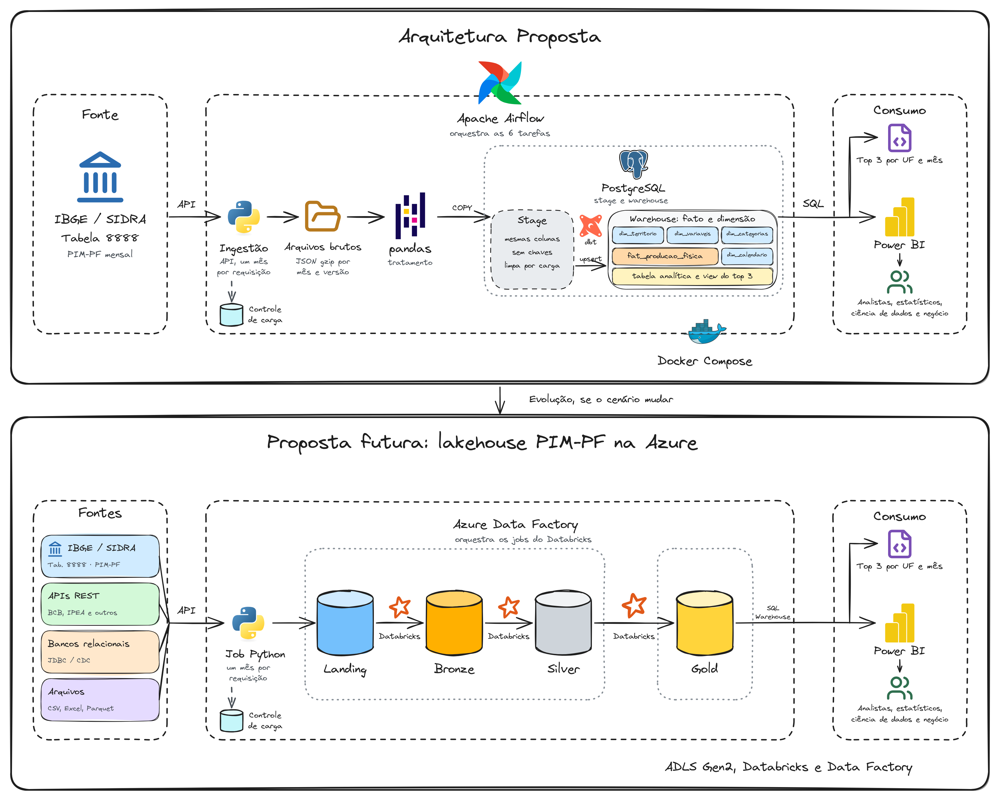
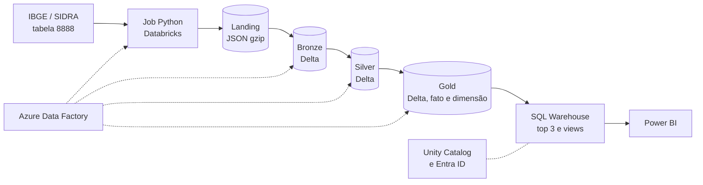

# Proposta futura: lakehouse em camadas na Azure

- Diagrama editável, com a arquitetura atual e esta proposta: [arquitetura.excalidraw](../arquitetura.excalidraw)
- Arquitetura em uso: [API, pandas, dbt, Stage e warehouse em fato e dimensão](../ARQUITETURA.md)
- Decisão: [ADR 0014](../adr/0014-proposta-futura-na-azure.md)

Esta proposta **não será implementada na prova**. Ela registra como a solução pode evoluir, se o cenário mudar.

## Esclarecimentos

### Sessão 2026-11-07

- Ambiente: o Docker Compose dá lugar a serviços gerenciados da Azure, o Databricks processa e o Azure Data Factory orquestra, no lugar do Airflow. Cada camada fica no Azure Data Lake Storage (ADLS Gen2).
- Q: Onde a camada Gold fica disponível para as consultas SQL e para o Power BI? → A: Em tabelas Delta no ADLS, consultadas pelo SQL Warehouse do Databricks.
- Q: Quem chama a API do IBGE e grava a Landing? → A: Um código Python em um job do Databricks, acionado pelo Data Factory.
- Q: A API FastAPI de ingestão continua existindo? → A: Não. O Data Factory aciona o job direto, e o status fica no monitoramento do Data Factory e do Databricks.
- Q: Como os serviços e as pessoas recebem acesso aos dados? → A: Pelo Unity Catalog, com grupos do Entra ID (o Power BI só lê a Gold), e identidades gerenciadas para o Data Factory e o Databricks acessarem o ADLS, sem chaves.

## Quando migrar

Hoje há uma fonte e cerca de 914 mil linhas, e a Stage com o warehouse em fato e dimensão atendem. A migração passa a valer a pena
quando ao menos um destes pontos ocorrer:

- Muitas novas fontes passarem a compartilhar a mesma plataforma.
- O volume ou o processamento deixarem de caber bem em um banco e uma máquina.
- Cientistas de dados precisarem ler grandes volumes em arquivos, sem passar pelo banco.
- For preciso consultar o histórico de versões dos dados com frequência.
- As consultas analíticas passarem a competir com as cargas no banco.
- A organização já usar a Azure e quiser os dados na mesma plataforma de outras equipes.

## Visão geral

Landing, Bronze, Silver e Gold são containers do mesmo ADLS Gen2. O Unity Catalog registra as tabelas e controla quem lê cada camada.

## Camadas

| | Landing | Bronze | Silver | Gold |
|---|---|---|---|---|
| **Propósito** | Guardar o arquivo como a fonte entregou | Tornar os dados consultáveis, sem interpretá-los | Versão confiável e completa | Consumo analítico via SQL |
| **Formato** | JSON gzip e manifesto | Delta, com colunas como texto | Delta tipado | Delta, em fato e dimensões, com as views analíticas |
| **Local no ADLS** | `landing/sidra/tabela=8888/periodo=AAAAMM/ingestao=.../` | `bronze/pim_pf/`, particionada por ano | `silver/pim_pf/`, particionada por ano | `gold/`, schema `analitico` no Unity Catalog |
| **Escrita** | Só acrescenta | Acrescenta os meses alterados; o histórico do Delta guarda as versões | `MERGE` dos meses afetados | `MERGE` em transação, com as dimensões antes do fato |
| **Quem lê** | Só o pipeline | Engenharia de dados | Engenharia e ciência de dados | Analistas, Power BI e ciência de dados |

O controle de carga (hash e situação de cada mês) passa a ser uma tabela Delta no mesmo catálogo.

## Orquestração

Um pipeline do Data Factory, agendado diariamente, com os mesmos parâmetros de hoje (`modo`, `inicio` e `fim`):

1. Verificar novidades. Sem novidade, a execução termina.
2. Executar o job de ingestão, que grava a Landing só com os meses cujo hash mudou.
3. Executar o job da Bronze.
4. Executar o job da Silver.
5. Validar o lote na Silver. Uma reprovação interrompe a execução antes da Gold.
6. Executar o job da Gold.
7. Testar o resultado publicado.

Cada atividade aciona um job do Databricks. Falhas e tempos aparecem no monitoramento do Data Factory e do Databricks, sem uma API própria.

## O que muda em relação à arquitetura atual

| Item | Atual | Futuro |
|---|---|---|
| Ambiente | Docker Compose em uma máquina | Serviços gerenciados da Azure |
| Orquestração | Airflow, com 6 tarefas | Pipeline do Data Factory, com 7 atividades |
| Ponto de entrada da ingestão | API FastAPI, com status em `controle.execucao_ingestao` | Data Factory aciona o job direto; status no monitoramento |
| Extração | Python na API | O mesmo código Python, em um job do Databricks |
| Armazenamento bruto | Volume Docker | Container `landing` do ADLS Gen2 |
| Etapas intermediárias | Stage no PostgreSQL | Bronze e Silver em Delta no ADLS |
| Processamento | pandas e dbt | PySpark nos jobs do Databricks |
| Modelo de consumo | Fato e dimensões no schema `warehouse` do PostgreSQL | O mesmo modelo, em Delta na Gold |
| Consulta SQL e Power BI | PostgreSQL, com usuário `pim_leitura` | SQL Warehouse do Databricks, com grupos do Entra ID |
| Credenciais | Senhas no `.env` | Identidades gerenciadas, sem chaves |

## O que continua igual

Hash por mês, tratamento dos símbolos, regras de validação, validação do lote antes de publicar, nomes das tabelas e das colunas
do modelo de consumo e o painel do Power BI, que só troca a fonte de dados.

## Caminho de migração

1. Criar o ADLS Gen2 com os containers das camadas, o workspace do Databricks com o Unity Catalog e o Data Factory, com identidades gerenciadas.
2. Copiar os arquivos brutos para a Landing; eles já seguem a organização por mês e versão.
3. Levar `fonte.py` e `extracao.py` para o job de ingestão, trocando o volume local pelo ADLS e o controle no PostgreSQL por uma tabela Delta.
4. Migrar o tratamento de pandas para PySpark, nos jobs da Bronze e da Silver.
5. Publicar o fato, as dimensões e as views na Gold, com os mesmos nomes de colunas, e apontar o Power BI para o SQL Warehouse.
6. Comparar os resultados com o modelo atual antes de desligá-lo: 914.166 linhas no fato, 2.004 na view e 612 no top 3, em 2025.

## Riscos

| Item | Impacto | Mitigação |
|---|---|---|
| Custo dos clusters e do SQL Warehouse para um volume pequeno | Gasto maior que o da arquitetura atual | Clusters de jobs, que desligam ao terminar, e SQL Warehouse com desligamento automático. Medir antes de migrar |
| Dependência da Azure e do Databricks | Troca de fornecedor fica mais cara | Delta é um formato aberto, e a lógica de domínio continua em Python e SQL |
| Lógica hoje em pandas e dbt | Retrabalho na migração | Os testes atuais e a comparação final dos números servem de aceite |
