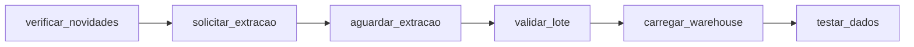

# Contrato: DAG `pim_pf_8888`

| Tarefa | Operador | Ação | Falha |
|---|---|---|---|
| `verificar_novidades` | `ShortCircuitOperator` | `GET /fonte/novidades`; só no modo `auto` | Sem novidade: encerra, sem erro |
| `solicitar_extracao` | `PythonOperator` | `POST /extracoes/producao-fisica`; `409` adota a execução em aberto; XCom só com `execucao_id` | Novas tentativas |
| `aguardar_extracao` | `PythonSensor`, `reschedule`, a cada 30 s, até 1 h | `GET /execucoes/{id}` | `falha` ou `interrompida` encerra sem nova tentativa |
| `validar_lote` | `DockerOperator` | `dbt test --select source:stage` | Sem novas tentativas; o warehouse não muda, e os meses seguem pendentes |
| `carregar_warehouse` | `DockerOperator` | `dbt run` | Novas tentativas |
| `testar_dados` | `DockerOperator` | `dbt test --exclude source:stage` | Sem novas tentativas; a execução fica como falha, com o dado já publicado |

## Configuração

| Item | Valor |
|---|---|
| `schedule` | `@daily` |
| `catchup` | `False` |
| `max_active_runs` | 1 |
| `retries` | 3, com espera crescente a partir de 1 min |

## Parâmetros do disparo manual

| Parâmetro | Valores | Uso |
|---|---|---|
| `modo` | `auto`, `completa`, `reprocessar` | Outros modos pulam a verificação de novidades |
| `inicio`, `fim` | `AAAA-MM` ou vazio | Repassados à API, que valida as regras |

## DockerOperator

| Item | Valor |
|---|---|
| `image` | `pim-pf-dbt:1.0` |
| `network_mode` | `pim_pf_rede` |
| `docker_url` | `unix://var/run/docker.sock` |
| `mount_tmp_dir` | `False` |
| `auto_remove` | `success` |
| `environment` | Host, porta, banco e usuário |
| `private_environment` | Senha do banco |
