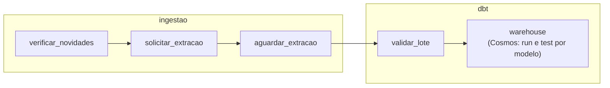

# Contrato: DAG `pim_pf_8888`

As tarefas ficam em dois grupos (`TaskGroup`), com o prefixo do grupo no id, como `ingestao.solicitar_extracao`:

| Grupo | Tarefa | Operador | Ação | Falha |
|---|---|---|---|---|
| `ingestao` | `verificar_novidades` | `ShortCircuitOperator` | `GET /fonte/novidades`; só no modo `auto` | Sem novidade: encerra, sem erro |
| `ingestao` | `solicitar_extracao` | `PythonOperator` | `POST /extracoes/producao-fisica`; `409` adota a execução em aberto; XCom só com `execucao_id` | Novas tentativas |
| `ingestao` | `aguardar_extracao` | `PythonSensor`, `reschedule`, a cada 30 s, até 1 h | `GET /execucoes/{id}` | `falha` ou `interrompida` encerra sem nova tentativa |
| `dbt` | `validar_lote` | `DockerOperator` | `dbt test --select source:stage` | Sem novas tentativas; o warehouse não muda, e os meses seguem pendentes |
| `dbt` | `warehouse` | `DbtTaskGroup` do Cosmos, modo Docker | Para cada modelo de `models/warehouse`, uma tarefa `run` e, em seguida, uma `test` com os testes dele, inclusive os de unidade | Sem novas tentativas; um teste reprovado deixa a execução como falha, com o dado já publicado |

No grupo `warehouse`, a ordem vem das dependências do `manifest.json`: as dimensões, depois o fato, a tabela analítica e as views.
O Airflow mostra só as tabelas. Os testes de chave estrangeira do fato não viram tarefas próprias: rodam dentro da tarefa
`test` dos modelos que eles leem, pela seleção indireta do dbt, e a do fato vem depois das dimensões.

## Configuração

| Item | Valor |
|---|---|
| `schedule` | `@daily` |
| `catchup` | `False` |
| `max_active_runs` | 1 |
| `retries` | 3, com espera crescente a partir de 1 min, no grupo `ingestao`; 0 no grupo `dbt` |

## Parâmetros do disparo manual

| Parâmetro | Valores | Uso |
|---|---|---|
| `modo` | `auto`, `completa`, `reprocessar` | Outros modos pulam a verificação de novidades |
| `inicio`, `fim` | `AAAA-MM` ou vazio | Repassados à API, que valida as regras |

## Cosmos

| Item | Valor |
|---|---|
| Versão | `astronomer-cosmos==1.15.1`, travada em `requirements/airflow.lock` |
| Leitura do projeto | `LoadMode.DBT_MANIFEST`, com o `manifest.json` gerado por `dbt parse` no build da imagem do Airflow |
| Seleção | `path:models/warehouse`; os testes da Stage ficam em `validar_lote` |
| Testes | `TestBehavior.AFTER_EACH` |
| Seleção indireta de testes | `TestIndirectSelection.BUILDABLE`: um teste que lê vários modelos roda só na tarefa `test` do último deles (os de FK, na do fato), e a primeira execução não testa tabela que ainda não existe |
| Execução | `ExecutionMode.DOCKER`, no contêiner `pim-pf-dbt:1.0`, com o projeto em `/app/dbt` |

## Contêiner do dbt (DockerOperator e Cosmos)

| Item | Valor |
|---|---|
| `image` | `pim-pf-dbt:1.0` |
| `network_mode` | `pim_pf_rede` |
| `docker_url` | `unix://var/run/docker.sock` |
| `mount_tmp_dir` | `False` |
| `auto_remove` | `success` |
| `environment` | Host, porta, banco e usuário |
| `private_environment` | Senha do banco |
