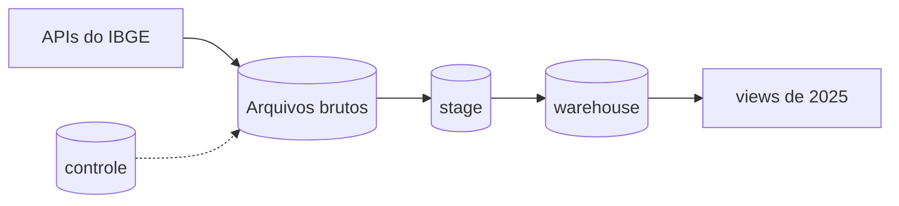
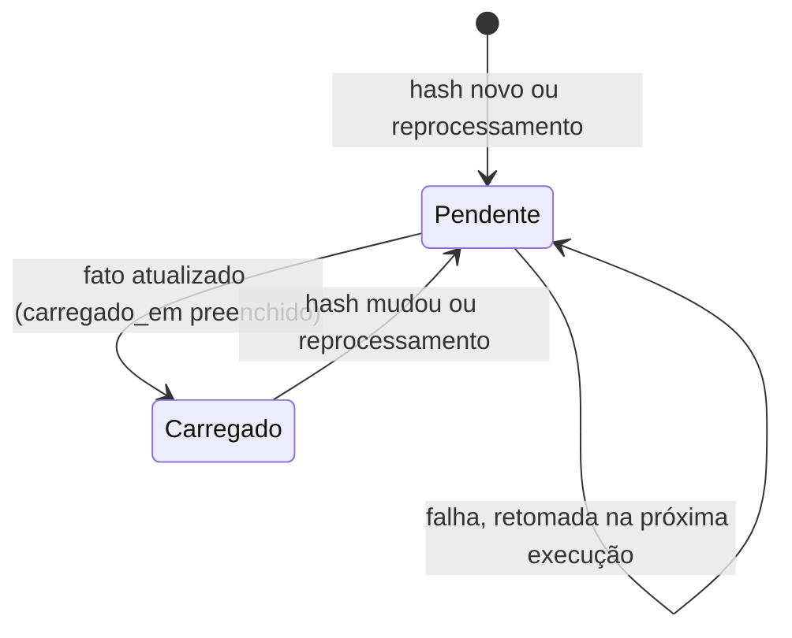
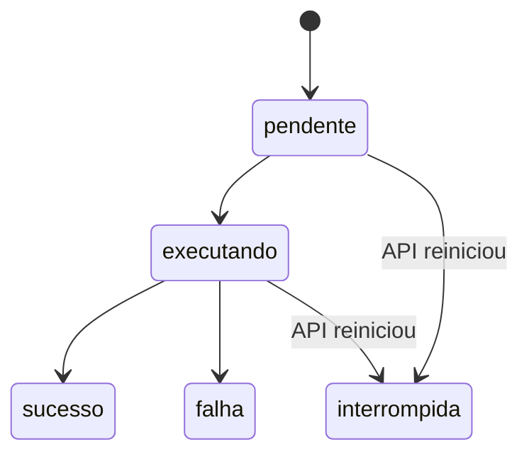
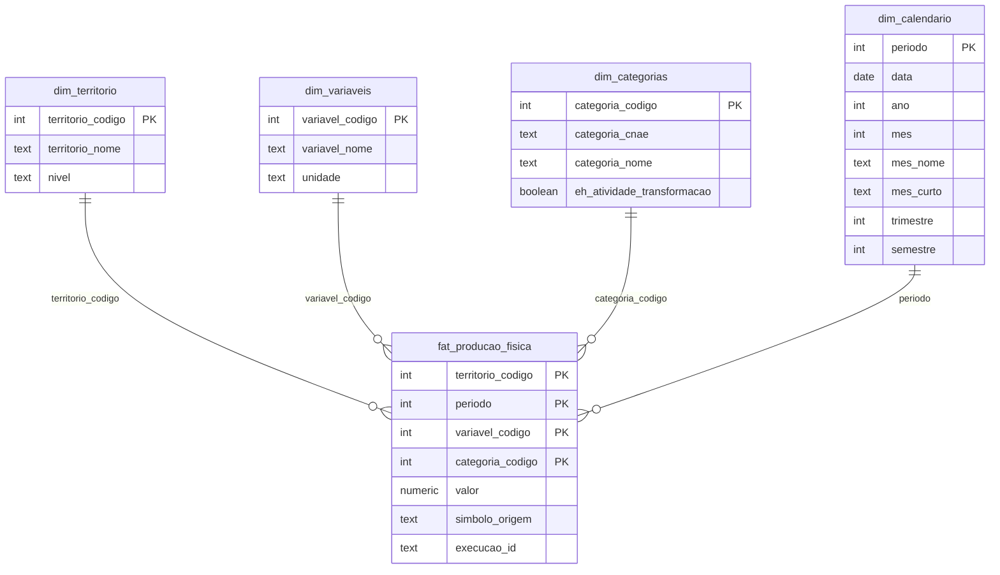

# Data Model: Pipeline da PIM-PF



## Arquivos brutos

Volume `dados_brutos`, somente acréscimo. Cada pasta tem `dados.json.gz` e `manifesto.json`.

```text
raw/sidra/tabela=8888/periodo=AAAAMM/ingestao=AAAAMMDDTHHMMSS/
raw/sidra/tabela=8888/metadados/ingestao=AAAAMMDDTHHMMSS/
raw/sidra/tabela=8888/localidades/ingestao=AAAAMMDDTHHMMSS/
```

O manifesto guarda URL, recurso ou período, data da fonte, data de ingestão, execução, hash SHA-256 e contagens.

## Schema `controle`

### `carga_periodo` (existente, sem mudança de colunas)

Uma linha por mês, com chave `periodo`: `data_fonte`, `hash_conteudo`, `arquivo`, `linhas`, `linhas_numericas`, `linhas_uf_numericas`, `completo`,
`execucao_id`, `ingestao_em` e `carregado_em`.

Situação do mês:



### `carga_recurso` (nova)

Última versão dos arquivos de `metadados` e `localidades`.

| Coluna | Tipo | Regra |
|---|---|---|
| `recurso` | text | Chave; `metadados` ou `localidades` |
| `hash_conteudo` | char(64) | Só grava nova versão se mudar |
| `arquivo` | text | Não nulo |
| `execucao_id` | text | Não nulo |
| `ingestao_em` | timestamptz | Não nulo |

### `execucao_ingestao` (nova)

| Coluna | Tipo | Regra |
|---|---|---|
| `execucao_id` | text | Chave; UUID |
| `tabela` | text | `variaveis`, `territorio`, `categoria` ou `producao_fisica` |
| `modo` | text | `auto`, `completa` ou `reprocessar` |
| `inicio`, `fim` | integer | AAAAMM; ambos nulos ou ambos preenchidos; no máximo 24 meses |
| `situacao` | text | Ver abaixo |
| `periodos_gravados`, `periodos_sem_mudanca` | integer | Padrão 0 |
| `periodos_parciais` | integer[] | Meses sinalizados como parciais |
| `meses_gravados`, `meses_stage` | integer[] | Meses com nova versão bruta e meses carregados na Stage |
| `linhas_stage`, `nulos_stage` | jsonb | Contagem por tabela da Stage |
| `causa_tipo`, `causa_mensagem` | text | Só em falha; sem detalhes internos |
| `criada_em`, `iniciada_em`, `concluida_em` | timestamptz | `criada_em` não nulo |

**Índice único parcial** com expressão constante, onde `situacao IN ('pendente', 'executando')`: permite só uma execução em aberto ([research.md](research.md), seção 6).



## Schema `stage`

Sem chaves. Cada carga esvazia e recarrega as tabelas envolvidas, em uma transação. Todas têm `path_origem` (text) e `data_carga` (timestamptz).

| Tabela | Colunas de negócio | Fonte |
|---|---|---|
| `variaveis` | `variavel_codigo`, `variavel_nome`, `unidade` | `/metadados` |
| `categoria` | `categoria_codigo`, `categoria_cnae`, `categoria_nome`, `eh_atividade_transformacao` | `/metadados` |
| `territorio` | `territorio_codigo`, `territorio_nome`, `nivel` | `/localidades/N1\|N2\|N3` |
| `producao_fisica` | `territorio_codigo`, `periodo`, `variavel_codigo`, `categoria_codigo`, `valor` numeric(14,5), `simbolo_origem`, `execucao_id` | `/values` |

## Schema `warehouse`

Criado pelo dbt com contratos e `merge`. Todas as tabelas têm `path_origem` e `data_carga`, não nulos.



### Tabela analítica e view

| Objeto | Grão | Colunas |
|---|---|---|
| `fato_producao_fisica_industrial_2025` (tabela) | UF × mês × atividade | `territorio_codigo`, `periodo`, `categoria_codigo`, `indice_producao`, `media_atividades_uf_mes`, `diferenca_para_media`, `path_origem`, `data_carga` |
| `vw_top3_transformacao_2025` (view) | UF × mês × posição | `uf_codigo`, `uf_nome`, `periodo`, `atividade_codigo`, `atividade_cnae`, `atividade_nome`, `indice_producao`, `media_atividades_uf_mes`, `diferenca_para_media` e `posicao` (1 a 3) |

A tabela é lida pela view e pelo Power BI. A `vw_transformacao_2025`, que existia antes, foi removida em 2026-11-09:
a tabela já tem a média e a diferença.

Filtros: variável 12606, nível `N3`, atividade `3.NN`, valor não nulo e ano 2025.

## Regras de validação

| Regra | Onde | Em caso de falha |
|---|---|---|
| Linhas = territórios × variáveis × categorias | Bruto | Interrompe, antes do tratamento |
| Variáveis, categorias e territórios iguais aos de metadados e localidades | Bruto | Interrompe, com alerta de mudança na fonte |
| Código novo ou removido em relação à versão anterior | Extração | Interrompe, sem gravar; o modo `completa` aceita |
| Chaves não nulas e únicas, `nivel` aceito e fato ligado às dimensões | Testes do lote, na Stage | Interrompe antes de publicar |
| Símbolo na lista conhecida (`-`, `..`, `...`, `X`) | Tratamento | Interrompe, antes da Stage |
| Índice não negativo | Tratamento | Interrompe, antes da Stage |
| Duplicidade na chave | Tratamento | Mantém uma linha e registra a contagem |
| Chaves primárias e estrangeiras | `warehouse` | O banco rejeita, e a transação é desfeita |
| 17 UFs e 12 meses, atividades `3.NN`, soma das diferenças próxima de zero, ao menos 3 atividades, caso do Ceará | Testes do dbt | A execução falha |
| Top 3 com exatamente 3 linhas por UF e mês | Teste do dbt | A execução falha |

## Permissões

`pim_leitura` só lê o schema `warehouse`, inclusive as tabelas e views que o dbt criar depois.
