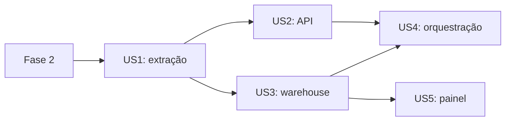

---

description: "Lista de tarefas do pipeline da PIM-PF, da extração ao painel analítico"
---

# Tasks: Pipeline da PIM-PF, da extração ao painel analítico

**Input**: Design documents from `specs/001-pipeline-pim-pf/`

**Prerequisites**: [plan.md](plan.md), [spec.md](spec.md), [research.md](research.md), [data-model.md](data-model.md), [contracts/](contracts/), [quickstart.md](quickstart.md)

**Tests**: incluídos porque a spec os exige (FR-020 e FR-029). Escreva os testes de cada história antes da implementação e confirme que falham.

**Organization**: tarefas agrupadas por história. Veja em "Dependencies" por que a ordem das fases difere da prioridade.

## Format: `[ID] [P?] [Story] Description`

- **[P]**: pode rodar em paralelo (arquivos diferentes, sem dependência de tarefa pendente)
- **[Story]**: história da spec (US1 a US5)
- Rode tudo em contêiner: o Python local é 3.14, e o projeto usa 3.12.
- Código e documentação em português do Brasil.

## Phase 1: Setup (Shared Infrastructure)

**Purpose**: registrar o estado atual e preparar as dependências e a imagem da ingestão

- [X] T001 Com a aprovação do candidato, faça um commit do pipeline atual antes de reorganizá-lo, para o Git poder comparar e reverter; confira com `git status` que só entram arquivos do projeto (repositório inteiro)
- [X] T002 [P] Crie `requirements/ingestao.txt` com versões exatas: `fastapi==0.162.2`, `uvicorn==0.54.0`, `pydantic==2.14.3`, `requests==2.34.2`, `pandas==3.1.0`, `psycopg2-binary==2.9.13`
- [X] T003 [P] Crie `requirements/testes.txt` com `-r ingestao.txt`, `pytest==9.2.0` e `httpx==0.28.1`
- [X] T004 [P] Crie `docker/ingestao/Dockerfile` a partir de `python:3.12.13-slim-bookworm`: instale `requirements/testes.txt`, copie `src/` e `tests/`, defina `PYTHONPATH=/app/src`, crie o usuário sem privilégios e a pasta de dados; o comando padrão é `uvicorn pim_pf.api:app --host 0.0.0.0 --port 8000 --workers 1`
- [X] T005 [P] Atualize `.dockerignore`: troque `!requirements.txt` por `!requirements`, mantendo a regra de negar o restante
- [X] T006 [P] Em `.gitignore`, acrescente `powerbi/**/.pbi/` e `powerbi/**/cache.abf`, sem remover nenhuma regra existente
- [X] T007 [P] Em `.env.example`, acrescente `INGESTAO_PORTA=8000` e mantenha só valores de exemplo

---

## Phase 2: Foundational (Blocking Prerequisites)

**Purpose**: banco, rede e serviço de ingestão no ar, base de todas as histórias

**⚠️ CRITICAL**: nenhuma história começa antes desta fase terminar

- [X] T008 Reescreva `sql/init/01-estrutura.sh` conforme [data-model.md](data-model.md): schemas `controle`, `stage` e `warehouse`; banco `airflow`; `controle.carga_periodo` sem mudança de colunas; `controle.carga_recurso` (chave `recurso`, "`metadados` ou `localidades`"; `hash_conteudo` char(64), "só grava nova versão se mudar"; `arquivo`, `execucao_id` e `ingestao_em` não nulos); `controle.execucao_ingestao` com todas as colunas do modelo e `CHECK` para `tabela`, `modo` e `situacao`; `inicio` e `fim` em integer AAAAMM, "ambos nulos ou ambos preenchidos"; `criada_em` não nulo
- [X] T009 No mesmo `sql/init/01-estrutura.sh`, crie o índice único parcial sobre expressão constante `WHERE situacao IN ('pendente', 'executando')`; as tabelas `stage.variaveis`, `stage.categoria`, `stage.territorio` e `stage.producao_fisica`, sem chaves, com `path_origem` (text) e `data_carga` (timestamptz), `valor` em numeric(14,5); e o papel `pim_leitura`, só leitura em `warehouse`, inclusive tabelas futuras (`ALTER DEFAULT PRIVILEGES`)
- [X] T010 [P] Anote o retorno de `conectar` em `src/pim_pf/banco.py` (`psycopg2.extensions.connection`), corrigindo a pendência da constituição
- [X] T011 [P] Crie `tests/conftest.py` com amostras de `/values`, `/metadados` e `/localidades`, e uma fonte falsa que registra chamadas e pode falhar; nenhum teste acessa a API real
- [X] T012 [P] Crie em `tests/test_api.py` os testes de `GET /health`, com `TestClient`: `200` com `{ "status": "ok" }` se o banco responder, e `503` com `{ "status": "indisponivel" }` se não, sem depender da fonte
- [X] T013 Crie `src/pim_pf/api.py` com a aplicação FastAPI, a configuração de `logging` e `GET /health`, conforme [contrato](contracts/api-ingestao.md)
- [X] T014 Refaça `docker-compose.yml` com `postgres` e `ingestao`: rede `pim_pf_rede` de nome fixo; portas em `127.0.0.1`; `postgres` montando `./sql/init` e `./sql/top3_por_uf_mes.sql:/sql/top3_por_uf_mes.sql:ro`; `ingestao` com o volume `dados_brutos`, `depends_on` com banco saudável e `healthcheck` por `python -c` em `/health`, pois a imagem não tem `curl`. Os serviços do Airflow saem até a Fase 6; o `Dockerfile` da raiz e o `requirements.txt` continuam no repositório até lá
- [X] T015 Valide com `docker compose down -v`, `docker compose up -d --build` e `docker compose run --rm ingestao pytest`: serviços saudáveis e `tests/test_api.py` aprovado; os testes antigos que dependem de mudanças futuras podem falhar até a Fase 3 (`docker-compose.yml`)

**Checkpoint**: banco e API de saúde funcionando; as histórias podem começar

---

## Phase 3: User Story 1 - Extrair a PIM-PF para a área de carga (Priority: P1) 🎯 MVP

**Goal**: extrair, guardar, tratar e carregar as quatro tabelas da Stage, com origem e data de carga

**Independent Test**: rodar `docker compose exec ingestao python -m pim_pf.carga producao_fisica` e consultar as quatro tabelas da `stage`

### Tests for User Story 1 ⚠️

- [X] T016 [P] [US1] Crie `tests/test_fonte.py`: `buscar_localidades` junta N1, N2 e N3; toda chamada usa `timeout` e `raise_for_status`; esgotar as tentativas gera `FonteIndisponivel`; metadados sem `variaveis` ou `classificacoes` geram `EstruturaAlterada`
- [X] T017 [P] [US1] Amplie `tests/test_tratamento.py`: `tratar_variaveis` (6 linhas, com unidade), `tratar_categorias` (a 3.20, código 56689, é atividade; o agregado "3" não é) e `tratar_territorio` (grava `N1`, `N2` e `N3`)
- [X] T018 [P] [US1] Crie `tests/test_janela_periodos.py`: controle vazio escolhe todos os meses; carga interrompida escolhe os ausentes; normalmente, os 3 últimos publicados mais os parciais; intervalo substitui a janela; mês fora da fonte gera `PeriodosIndisponiveis`; a data nova em mês antigo fora da janela não é novidade
- [X] T019 [P] [US1] Amplie `tests/test_extracao.py`: `auto` não grava hash igual; `completa` regrava sem comparar; `reprocessar` e `validar_brutos` fazem zero chamadas à fonte; falta de arquivo gera `SemDadoBruto`; recurso com hash igual não cria pasta nova
- [X] T020 [P] [US1] Crie `tests/test_carga.py` com cursor simulado: cada tabela esvazia só a sua Stage; `producao_fisica` carrega também as dimensões; todas as linhas têm `path_origem` e `data_carga`; dado inválido impede o `COPY`

### Implementation for User Story 1

- [X] T021 [US1] Em `src/pim_pf/fonte.py`, acrescente `buscar_localidades`, as exceções `FonteIndisponivel` e `EstruturaAlterada` e a validação da estrutura dos metadados, mantendo `Retry` e `TEMPO_LIMITE`
- [X] T022 [US1] Em `src/pim_pf/tratamento.py`, crie `tratar_variaveis`, `tratar_categorias` e `tratar_territorio`; reduza `separar_tabelas` à `producao_fisica`, com as colunas da Stage em [data-model.md](data-model.md), sem `ingestao_em` nem `origem_arquivo`
- [X] T023 [US1] Em `src/pim_pf/extracao.py`, crie `periodos_alvo` com a regra da seção 1 de [research.md](research.md) (ausentes, 3 últimos publicados e parciais; ou o intervalo; ou todos em `completa`) e a exceção `PeriodosIndisponiveis`; substitua `_periodos_escolhidos` e o parâmetro `periodos` por `inicio` e `fim`
- [X] T024 [US1] Em `src/pim_pf/extracao.py`, crie a gravação de `metadados` e `localidades` em pastas `raw/sidra/tabela=8888/{recurso}/ingestao=AAAAMMDDTHHMMSS/`, com manifesto e `controle.carga_recurso`, só quando o hash mudar
- [X] T025 [US1] Em `src/pim_pf/extracao.py`, altere `verificar_novidades` para devolver `ha_novidade`, `meses_alterados` e `meses_pendentes`, comparando só os meses-alvo; altere `validar_brutos` para ler os metadados do último arquivo guardado, sem acessar a fonte, e lançar `EstruturaAlterada` (corrige o acesso à fonte que hoje ocorre mesmo em `reprocessar`); use `SemDadoBruto` no reprocessamento sem arquivo
- [X] T026 [US1] Em `src/pim_pf/carga.py`, crie `executar_extracao(tabela, modo, inicio, fim, execucao_id) -> dict`, com extração, validação e tratamento e, em uma só transação, `TRUNCATE` e `COPY` só das tabelas envolvidas, com nomes vindos de constantes; devolva gravados, sem mudança, parciais, linhas e nulos por tabela; registre esses valores no log e remova `executar_dbt`, `carregar_dw` e `testar_dados`
- [X] T027 [US1] Em `src/pim_pf/carga.py`, acrescente a entrada `python -m pim_pf.carga <tabela> [--modo] [--inicio] [--fim]`, usada na validação sem API
- [X] T028 [US1] Valide na fonte real pelo comando de T027 (`docker-compose.yml`): `stage.producao_fisica` com 3.078 linhas por mês, 6 variáveis, 27 categorias e 19 territórios; repetir sem novidade não grava nada; `reprocessar` não cria pastas em `raw/`. Registre qualquer fato novo em `docs/fonte-sidra-8888.md`

**Checkpoint**: Stage carregada e reprocessável, sem API nem orquestrador

---

## Phase 4: User Story 3 - Publicar o modelo analítico e responder às perguntas da prova (Priority: P1)

**Goal**: warehouse em fato e dimensões, views de 2025 e consulta do top 3

**Independent Test**: com a Stage carregada, rodar `docker compose run --rm dbt dbt run` e `dbt test`, conferindo os valores do Ceará

### Tests for User Story 3 ⚠️

- [X] T029 [P] [US3] Crie `dbt/models/warehouse/unit_tests.yml` com `unit_tests` do dbt para `vw_transformacao_2025`: atividade com `valor` nulo fica fora da média, agregado "3" fica fora, e a diferença é o índice menos a média; e para `vw_top3_transformacao_2025`: 3 linhas com desempate pelo código
- [X] T030 [P] [US3] Atualize as referências em `dbt/tests/ceara_janeiro_2025.sql`, `dbt/tests/soma_das_diferencas_e_zero.sql`, `dbt/tests/top3_tem_3_atividades.sql`, `dbt/tests/view_so_tem_atividades_3nn.sql` e `dbt/tests/view_tem_17_ufs_e_12_meses.sql`; renomeie `dbt/tests/dcalendario_tem_anos_completos.sql` para `dbt/tests/dim_calendario_tem_anos_completos.sql`
- [X] T031 [P] [US3] Crie `dbt/tests/top3_ceara_janeiro_2025.sql`, que falha se Ceará em 202501 não trouxer 3.13, 3.24 e 3.11, nessa ordem, em `vw_top3_transformacao_2025`

### Implementation for User Story 3

- [X] T032 [US3] Em `dbt/dbt_project.yml` e `dbt/profiles.yml`, troque `dw` por `warehouse` como pasta, alvo e schema, mantendo `incremental` e `merge`; em `dbt/models/stage/sources.yml`, troque `variavel` por `variaveis`
- [X] T033 [US3] Mova `dbt/models/dw/` para `dbt/models/warehouse/`, renomeando para `dim_territorio.sql`, `dim_variaveis.sql`, `dim_categorias.sql`, `dim_calendario.sql` e `fat_producao_fisica.sql`; leve `path_origem` e `data_carga` da Stage sem alterar; em `dim_calendario`, use `path_origem` = `gerado:dbt` e `data_carga` = instante da execução
- [X] T034 [US3] Em `dbt/models/warehouse/fat_producao_fisica.sql`, acrescente o `post_hook` que preenche `controle.carga_periodo.carregado_em` nos meses presentes em `stage.producao_fisica` que estejam pendentes, conforme a seção 10 de [research.md](research.md)
- [X] T035 [US3] Atualize `dbt/models/warehouse/schema.yml` com os novos nomes, contratos, chaves primárias e estrangeiras, `path_origem` e `data_carga` não nulos e `vw_top3_transformacao_2025`
- [X] T036 [US3] Ajuste `dbt/models/warehouse/vw_transformacao_2025.sql` às novas referências, sem mudar a regra
- [X] T037 [US3] Crie `dbt/models/warehouse/vw_top3_transformacao_2025.sql` sobre a view anterior, com `ROW_NUMBER` por UF e mês, em ordem de índice decrescente e desempate por `atividade_codigo`, com colunas explícitas
- [X] T038 [P] [US3] Atualize `sql/top3_por_uf_mes.sql` para ler `warehouse.vw_transformacao_2025`, listando as colunas na projeção final (S1, S2)
- [X] T039 [US3] Crie `docker/dbt/Dockerfile` a partir de `python:3.12.13-slim-bookworm`, com `dbt-core==1.11.17` e `dbt-postgres==1.11.0` e o projeto `dbt/` copiado; `DBT_PROFILES_DIR`, `DBT_PROJECT_DIR`, `DBT_TARGET_PATH` e `DBT_LOG_PATH` em pastas temporárias
- [X] T040 [US3] Em `docker-compose.yml`, acrescente o serviço `dbt` com imagem `pim-pf-dbt:1.0`, `command: dbt --version`, `restart: "no"`, a rede `pim_pf_rede` e as variáveis `PIM_DB_*`
- [X] T041 [US3] Valide a Stage carregada com `dbt run` e `dbt test` (`docker-compose.yml`): 914.166 linhas ou 3.078 por mês, 2.004 na view, 612 no top 3, e valores do Ceará iguais a SC-005
- [X] T042 [US3] Force uma falha na carga do fato e confira se os meses seguem pendentes, para confirmar a hipótese do `post_hook`; registre o resultado em `specs/001-pipeline-pim-pf/research.md` e, se a hipótese falhar, ajuste `dbt/models/warehouse/fat_producao_fisica.sql` com `transaction: true` ou outra solução documentada

**Checkpoint**: as perguntas c e d da prova já têm resposta em SQL

---

## Phase 5: User Story 2 - Acionar e acompanhar a ingestão por uma API (Priority: P2)

**Goal**: API com os quatro endpoints de extração, status e verificação de novidades

**Independent Test**: rodar `tests/test_api.py` com a extração simulada e depois o cenário 5 de [quickstart.md](quickstart.md)

### Tests for User Story 2 ⚠️

- [X] T043 [P] [US2] Amplie `tests/test_api.py` conforme [contrato](contracts/api-ingestao.md): os 4 `POST` devolvem `202` com `execucao_id`; `status_url` funciona; `409` traz o `execucao_id` em aberto; `422` para mês mal formatado, `inicio` depois de `fim`, só um dos campos, mais de 24 meses, intervalo em `completa` e período em dimensão; `404` para execução inexistente; a tabela da rota `producao-fisica` vira `producao_fisica`
- [X] T044 [P] [US2] Em `tests/test_api.py`, teste que cada exceção vira o `causa.tipo` certo (`fonte_indisponivel`, `estrutura_alterada`, `dados_invalidos`, `periodos_indisponiveis`, `sem_dado_bruto`, `erro_interno`), que o `erro_interno` não expõe a mensagem original e que `GET /fonte/novidades` devolve `503` com a fonte fora
- [X] T045 [P] [US2] Crie `tests/test_execucoes.py`: transições `pendente` → `executando` → `sucesso` ou `falha`; ao iniciar, `pendente` e `executando` viram `interrompida`
- [X] T046 [P] [US2] Crie `tests/integracao/test_execucao_unica.py`: no PostgreSQL do Compose, duas execuções em aberto violam o índice, e tudo é desfeito com `rollback`; o teste é pulado se `PIM_DB_HOST` não estiver definido

### Implementation for User Story 2

- [X] T047 [US2] Crie `src/pim_pf/execucoes.py` com criar, iniciar, concluir, falhar, consultar e `marcar_interrompidas`, sobre `controle.execucao_ingestao`; a violação do índice vira a exceção `ExecucaoEmAndamento`, com o identificador em aberto
- [X] T048 [US2] Em `src/pim_pf/api.py`, crie os modelos Pydantic e as validações: `inicio` e `fim` em `AAAA-MM`, "ambos ou nenhum", `inicio` ≤ `fim`, "no máximo 24 meses", não aceitos com `completa`; o modelo das dimensões só aceita `modo` `auto` ou `reprocessar` e recusa campos extras
- [X] T049 [US2] Em `src/pim_pf/api.py`, crie `POST /extracoes/{tabela}` para `variaveis`, `categoria`, `territorio` e `producao-fisica`, delegando a `execucoes.py` e a `carga.executar_extracao` por `BackgroundTasks`; a rota só valida e delega
- [X] T050 [US2] Em `src/pim_pf/api.py`, crie `GET /execucoes/{execucao_id}` e `GET /fonte/novidades`; mapeie as exceções para `causa` e mantenha o detalhe do erro inesperado só no log
- [X] T051 [US2] Em `src/pim_pf/api.py`, chame `execucoes.marcar_interrompidas` na inicialização, pelo `lifespan` do FastAPI
- [X] T052 [US2] Valide o cenário 5 de [quickstart.md](quickstart.md) e meça o tempo de resposta do `202` em carga completa (SC-007); reinicie o contêiner durante uma execução e confira a situação `interrompida` (`docker-compose.yml`)

**Checkpoint**: ingestão operável pela API; a orquestração pode começar

---

## Phase 6: User Story 4 - Executar tudo de forma agendada e reproduzível (Priority: P1)

**Goal**: ambiente completo com um comando e DAG agendada do início ao fim

**Independent Test**: em um clone limpo, seguir o README, disparar a DAG e ver as 5 tarefas concluídas

### Tests for User Story 4 ⚠️

- [X] T053 [P] [US4] Crie `tests/test_cliente_api.py` com `requests` simulado: `solicitar` devolve o identificador em `202` e adota o de `409`; `execucao_concluida` devolve `False` em aberto, `True` em `sucesso` e falha com a causa em `falha` ou `interrompida`; `ha_novidade` lê `/fonte/novidades`; toda chamada usa `timeout`

### Implementation for User Story 4

- [X] T054 [US4] Crie `src/pim_pf/cliente_api.py`, só com `requests` e URL vinda de `PIM_API_URL`, sem pandas nem banco, conforme a seção 8 de [research.md](research.md)
- [X] T055 [P] [US4] Crie `docker/airflow/Dockerfile` a partir de `apache/airflow:3.4.0-python3.12`, copiando `dags/`, `src/pim_pf/__init__.py` e `src/pim_pf/cliente_api.py`, com `PYTHONPATH`, sem instalar pacotes; apague o `Dockerfile` da raiz e o `requirements.txt`
- [X] T056 [US4] Reescreva `dags/pim_pf_8888.py` conforme [contrato](contracts/dag-airflow.md): as 5 tarefas, `@daily`, `catchup=False`, `max_active_runs=1`, 3 novas tentativas com espera crescente, sensor sem novas tentativas, parâmetros `modo`, `inicio` e `fim`; o `DockerOperator` usa `pim-pf-dbt:1.0`, `pim_pf_rede`, `mount_tmp_dir=False`, `auto_remove="success"` e a senha em `private_environment`; o nível superior não acessa rede nem banco
- [X] T057 [US4] Em `docker-compose.yml`, restaure `airflow-init`, `airflow-apiserver`, `airflow-scheduler` e `airflow-dag-processor` com a nova imagem, sem os volumes de dados brutos e sem variáveis de dbt; acrescente `PIM_API_URL=http://ingestao:8000` e as variáveis repassadas ao `DockerOperator`; monte `/var/run/docker.sock` **somente** em `airflow-scheduler`; publique a porta do Airflow em `127.0.0.1`
- [X] T058 [US4] Em `docker-compose.yml`, faça o `airflow-scheduler` depender de `ingestao` saudável e de `dbt` concluído com sucesso
- [X] T059 [US4] Valide os cenários 1, 2, 3, 4 e 6 de [quickstart.md](quickstart.md), do zero, com `docker compose down -v` (`docker-compose.yml`): DAG sem erros de importação, 5 tarefas verdes, repetição sem novidade encerrada em `verificar_novidades` e reprocessamento sem acessar a fonte

**Checkpoint**: todas as questões exigidas pela prova estão atendidas

---

## Phase 7: User Story 5 - Analisar os resultados em um painel (Priority: P3)

**Goal**: painel com capa e análise, consumindo só o warehouse

**Independent Test**: abrir o projeto no Power BI Desktop, filtrar Ceará e janeiro de 2025 e comparar com a consulta SQL

### Implementation for User Story 5

- [X] T060 [P] [US5] Copie `requisitos/tema_powerbi_fiec_observatorio.json` para `powerbi/Observatorio.Report/StaticResources/RegisteredResources/`, local exigido pelo PBIR, pois `requisitos/` não entra no Git
- [X] T061 [P] [US5] Crie `capa.svg` e `analise.svg` em `powerbi/Observatorio.Report/StaticResources/RegisteredResources/`, em 16:9, com as cores do tema e áreas reservadas para os visuais de [contrato](contracts/painel.md)
- [X] T062 [US5] Crie o modelo semântico em `powerbi/Observatorio.SemanticModel/` (TMDL), com importação das 5 tabelas do contrato, parâmetros de servidor e porta, relacionamentos em uma direção e as 5 medidas
- [X] T063 [US5] Crie o relatório em `powerbi/Observatorio.Report/` e `powerbi/Observatorio.pbip`, com exatamente as telas de capa e análise, os filtros de UF e mês, os visuais, os títulos, a nota sobre atividades sem dado e o tema
- [X] T064 [US5] Candidato: abra `powerbi/Observatorio.pbip` no Power BI Desktop, atualize com `pim_leitura`, corrija o que o Desktop apontar e valide o cenário 7 de [quickstart.md](quickstart.md)

**Checkpoint**: todas as histórias concluídas

---

## Phase 8: Polish & Cross-Cutting Concerns

**Purpose**: decisões, documentação e validação final da entrega

- [X] T065 [P] Crie `docs/arquitetura/adr/0011-api-de-ingestao.md`: por que uma API sem exigência na prova, execução em segundo plano e uma execução por vez
- [X] T066 [P] Crie `docs/arquitetura/adr/0012-dbt-em-conteiner-e-socket-docker.md`, com o risco do socket, a medição, a alternativa de dbt na imagem do Airflow e o que muda em produção, e atualize a consequência de contêiner em `docs/arquitetura/adr/0009-dbt-da-stage-ao-dw.md`
- [X] T067 [P] Crie `docs/arquitetura/adr/0013-nomes-do-warehouse.md`, com `warehouse`, `dim_*` e `fat_*`, e marque em `docs/arquitetura/adr/0010-dw-em-fato-e-dimensao.md` a parte dos nomes como substituída
- [X] T068 Com dados reais, rode `EXPLAIN` nas views e na consulta do top 3; crie índices só se o plano justificar, em `dbt/models/warehouse/fat_producao_fisica.sql`, e registre o resultado em `docs/arquitetura/ARQUITETURA.md`
- [X] T069 Atualize `docs/arquitetura/ARQUITETURA.md` com o novo desenho, as medições, a qualidade, a orquestração, os serviços, a rastreabilidade e as perguntas da entrevista
- [X] T070 [P] Atualize `docs/arquitetura/arquitetura.excalidraw` e `docs/arquitetura/arquitetura.png` com os contêineres de ingestão e dbt e o painel
- [X] T071 [P] Atualize `README.md`: como subir, testar, usar a API, reprocessar, migrar com `docker compose down -v`, finalidade de cada porta (FR-022) e limites do ambiente local
- [X] T072 [P] Atualize a tabela de caminhos em `CLAUDE.md` com `specs/`, `docker/` e `powerbi/`, e remova o que deixou de existir
- [X] T073 Audite os padrões de engenharia da constituição nos arquivos alterados: tipos anotados, sem `print`, sem `SELECT *` na projeção final, consultas parametrizadas e tipos explícitos no pandas, corrigindo o que faltar (`src/pim_pf/`, `dbt/`, `sql/`)
- [X] T074 Valide todo o [quickstart.md](quickstart.md) em um clone limpo, em outra pasta, fora do OneDrive se possível (SC-001, SC-011), e registre os resultados em `docs/arquitetura/ARQUITETURA.md`
- [X] T075 Registre a etapa em `docs/historico.md`, com o que foi feito, as decisões e as pendências

---

## Dependencies & Execution Order

### Phase Dependencies

- **Setup (Fase 1)**: sem dependências
- **Foundational (Fase 2)**: depende da Fase 1 e bloqueia todas as histórias
- **Histórias (Fases 3 a 7)**: seguem as dependências abaixo
- **Polish (Fase 8)**: depende das histórias desejadas

### User Story Dependencies

A ordem das fases difere da prioridade porque a US4 precisa da API da US2 (FR-023).



| História | Depende de | Teste isolado |
|---|---|---|
| US1 (P1) | Fase 2 | Comando direto e consulta à Stage |
| US3 (P1) | US1, ou a Stage preenchida | `dbt run` e `dbt test` por comando |
| US2 (P2) | US1 | Testes com a extração simulada e chamadas à API |
| US4 (P1) | US2 e US3 | DAG completa, em clone limpo |
| US5 (P3) | US3 | Power BI Desktop; não depende do Airflow |

### Within Each User Story

- Testes primeiro, confirmando que falham
- Tratamento e regras antes da carga; carga antes das rotas
- A validação com dados reais fecha a história

### Parallel Opportunities

- **Fase 1**: T002 a T007
- **Fase 2**: T010, T011 e T012, antes de T013
- **US3 e US2**: podem rodar em paralelo depois da US1, pois não alteram os mesmos arquivos
- **US5**: T060 e T061, e pode começar assim que a US3 terminar
- **Fase 8**: T065, T066, T067, T070, T071 e T072

---

## Parallel Example: User Story 1

```bash
# Testes da US1, em arquivos diferentes:
Task: "Crie tests/test_fonte.py"
Task: "Amplie tests/test_tratamento.py"
Task: "Crie tests/test_janela_periodos.py"
Task: "Amplie tests/test_extracao.py"
Task: "Crie tests/test_carga.py"
```

T021 a T027 alteram arquivos dependentes entre si e seguem em sequência.

---

## Implementation Strategy

### MVP First

O menor corte que atende às questões 2 e 3 da prova é **US1 + US3 + US2 + US4**. A API faz parte dele porque o candidato a definiu como ponto de entrada da ingestão.

1. Fases 1 e 2.
2. US1: **pare e valide** a Stage com dados reais.
3. US3: **pare e valide** os números do Ceará. As questões c e d já têm resposta.
4. US2 e US4: **pare e valide** a DAG.

### Incremental Delivery

Depois do MVP, acrescente a US5, e só então a Fase 8, com a validação em clone limpo. Se o prazo apertar, o painel é o primeiro corte, pois a prova não o exige.

---

## Notes

- Faça commits pequenos e descritivos ao fim de cada grupo, pois o histórico faz parte da entrega (E2), sempre com a autorização do candidato.
- Nunca use `dbt run --full-refresh`: a Stage só tem os meses alterados, e o warehouse perderia os demais.
- A implementação precisa ser explicável na entrevista: se uma tarefa exigir algo não previsto, registre o motivo em vez de acrescentar complexidade em silêncio.

---

## Phase 9: Convergence

- [X] T076 CRITICAL: valide o lote antes de publicar, conforme a seção 16 de `specs/001-pipeline-pim-pf/research.md`: em `dbt/models/stage/sources.yml` e `dbt/tests/`, crie testes sobre a Stage (chaves não nulas, unicidade nas dimensões e na chave do fato, `nivel` aceito, e fato ligado às dimensões da Stage); em `dags/pim_pf_8888.py`, crie a tarefa `validar_lote` com `dbt test --select source:stage`, sem novas tentativas, antes de `carregar_warehouse`, e troque `testar_dados` por `dbt test --exclude source:stage`; force um lote inválido e confira que o warehouse não muda e que os meses seguem pendentes; force um teste reprovado depois da publicação e confira que a DAG falha; atualize `specs/001-pipeline-pim-pf/contracts/dag-airflow.md`, `specs/001-pipeline-pim-pf/quickstart.md`, `docs/arquitetura/ARQUITETURA.md` e `README.md` per Constitution (SQL: publicação transacional), FR-015, SC-008, US3/AC5, US3/AC6 (contradicts)
- [X] T077 CRITICAL: troque as chamadas diretas de `src/pim_pf/cliente_api.py` por uma `Session` com novas tentativas e espera crescente, sem repetir o POST em falhas ambíguas além do que o tratamento do `409` já cobre, e teste em `tests/test_cliente_api.py` que uma falha passageira não derruba o sensor per Constitution (requests) (contradicts)
- [X] T078 CRITICAL: crie modelos Pydantic para `GET /health` e para a resposta `409` em `src/pim_pf/api.py`, mantendo os corpos de `specs/001-pipeline-pim-pf/contracts/api-ingestao.md` e os testes de `tests/test_api.py` per Constitution (FastAPI) (partial)
- [X] T079 Altere o `post_hook` de `dbt/models/warehouse/fat_producao_fisica.sql` para só marcar como carregado o mês cujo `path_origem` na Stage seja igual a `controle.carga_periodo.arquivo`, e verifique com um mês pendente de versão nova e a versão antiga na Stage que ele continua pendente per FR-015, FR-004 (partial)
- [X] T080 Em `src/pim_pf/extracao.py`, faça a carga falhar com `EstruturaAlterada` quando variáveis, categorias ou territórios mudarem em relação à versão guardada anterior, e compare os territórios dos valores com as localidades; defina como aceitar uma mudança legítima e cubra em `tests/test_extracao.py` per spec: edge case de mudança nos metadados (partial)
- [X] T081 [P] Crie `dbt/tests/top3_tem_exatamente_3_linhas.sql` sobre `vw_top3_transformacao_2025` e acrescente testes `unique` e `relationships` em `dbt/models/warehouse/schema.yml` per FR-020, data-model: top 3 com exatamente 3 linhas (partial)
- [X] T082 [P] Em `src/pim_pf/fonte.py`, junte as respostas de `/localidades` sem reserializar, preservando os bytes de cada uma em um JSON válido, e cubra em `tests/test_fonte.py` per FR-003, Constitution IV (partial)
- [X] T083 Em `src/pim_pf/api.py` e `src/pim_pf/execucoes.py`, trate falhas de `iniciar` e do registro final para a execução não ficar em aberto até um reinício; cubra em `tests/test_api.py` e atualize as consequências em `docs/arquitetura/adr/0011-api-de-ingestao.md` per FR-011 (partial)

---

## Phase 10: Convergence

- [X] T084 CRITICAL: registre quais meses cada execução tratou nos logs de `src/pim_pf/extracao.py` e `src/pim_pf/carga.py`, e acrescente os meses gravados ao status da execução em `src/pim_pf/execucoes.py`, `src/pim_pf/api.py`, `sql/init/01-estrutura.sh` e `specs/001-pipeline-pim-pf/contracts/api-ingestao.md`, com testes em `tests/test_api.py` e `tests/test_execucoes.py` per Constitution (Python: logs com identificação do período), FR-030 (partial)
- [X] T085 CRITICAL: faça `padronizar`, `tratar`, `tratar_variaveis`, `tratar_categorias` e `tratar_territorio`, em `src/pim_pf/tratamento.py`, receberem DataFrames, movendo a conversão do JSON para `src/pim_pf/carga.py`, sem mudar os resultados, e ajuste `tests/test_tratamento.py` per Constitution (pandas: funções de tratamento) (contradicts)
- [X] T086 CRITICAL: anote o tipo de `**opcoes` em `_dbt`, em `dags/pim_pf_8888.py` per Constitution (Python: anotação de tipos) (partial)

---

## Phase 11: Convergence

- [X] T087 CRITICAL: fixe todas as dependências Python das imagens, inclusive as indiretas: gere a partir das imagens validadas `requirements/ingestao.lock` e `requirements/dbt.lock` (saída de `pip freeze`), aplique-os com `-c` em `docker/ingestao/Dockerfile` e `docker/dbt/Dockerfile`, mova os pacotes do dbt para `requirements/dbt.txt`, reconstrua as imagens e confirme que os testes em Python e do dbt continuam aprovados per Constitution V, Constitution (Docker: dependências com versão fixa) (partial)
- [X] T088 Corrija a primeira execução com o warehouse vazio: em `dags/pim_pf_8888.py`, use `ExecutionConfig(test_indirect_selection=TestIndirectSelection.BUILDABLE)` para os testes de FK e o `fato_so_tem_atividades_3nn` saírem do `test` das dimensões e rodarem só depois de o fato existir; atualize o ADR 0015 e `contracts/dag-airflow.md`; valide reexecutando a execução que falhou, com o fato ainda inexistente (spec: Edge Cases, "Primeira execução com o warehouse vazio")
