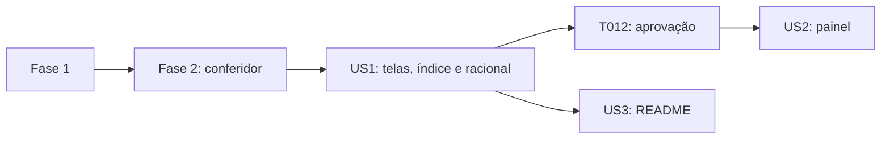

---

description: "Lista de tarefas do mockup do painel Power BI"
---

# Tasks: Mockup do painel Power BI

**Input**: Design documents from `specs/002-mockup-power-bi/`

**Prerequisites**: [plan.md](plan.md), [spec.md](spec.md), [research.md](research.md), [data-model.md](data-model.md), [contracts/telas-mockup.md](contracts/telas-mockup.md), [quickstart.md](quickstart.md)

**Tests**: incluídos porque a spec exige verificação automática (FR-014, SC-001 e SC-005). O conferidor é escrito antes das telas e precisa falhar primeiro.

**Organization**: tarefas agrupadas por história. A US2 depende do mockup aprovado na US1.

## Format: `[ID] [P?] [Story] Description`

- **[P]**: pode rodar em paralelo (arquivos diferentes, sem dependência de tarefa pendente)
- **[Story]**: história da spec (US1 a US3)
- Regras de origem: `requisitos/pbi-mockup` (SKILL.md, `references/` e `templates/`). Essa pasta não é versionada, então leia-a diretamente.
- Os scripts rodam na imagem `pim-pf-ingestao:1.0`, com `mockup/` montada; o Python local é 3.14 e não deve ser usado.

## Phase 1: Setup (Shared Infrastructure)

**Purpose**: pasta do mockup, validador e consulta dos números

- [X] T001 Crie a pasta `mockup/` e copie, sem alterações, `requisitos/pbi-mockup/scripts/check_bounds.py` para `mockup/ferramentas/check_bounds.py`
- [X] T002 [P] Crie `mockup/dados-referencia.sql` com três consultas a `warehouse`, com colunas explícitas: (1) as atividades do Ceará (`uf_codigo = 23`) em `periodo = 202501`, de `vw_transformacao_2025`, com `atividade_cnae`, `atividade_nome`, `indice_producao`, `diferenca_para_media` e `media_atividades_uf_mes`, ordenadas por índice decrescente; (2) a média das atividades do Ceará por `periodo` em 2025; (3) a maior `data_carga` de `fat_producao_fisica`

---

## Phase 2: Foundational (Blocking Prerequisites)

**Purpose**: o conferidor que define quando as telas estão certas

**⚠️ CRITICAL**: as telas da US1 só são aceitas quando o conferidor e o validador passam

- [X] T003 Crie `mockup/conferir_mockup.py` com tipos anotados e `logging`, lendo o banco pelas variáveis `PIM_DB_*`. Ele deve: executar `mockup/dados-referencia.sql`; formatar os valores no padrão brasileiro com duas casas (`145,03`), as diferenças com sinal (`+43,45`, aceitando `−` ou `-`) e a data como `08/11/2026`; exigir que cada índice, diferença, média (`101,58`), as 12 médias mensais, a contagem (`11`), "5 de 11" e a data apareçam em algum `<text>` de `mockup/tela-02-analise.svg`; verificar nas duas telas que o XML é bem formado, que não há `<use>`, `<symbol>` nem `currentColor` e que cada `url(#x)` aponta para um gradiente ou recorte, e não para um grupo; e terminar com código 1 se algo falhar
- [X] T004 Rode o conferidor antes de existirem telas e confirme que ele falha apontando os arquivos ausentes (`mockup/conferir_mockup.py`)

**Checkpoint**: critério de aceite automático pronto

---

## Phase 3: User Story 1 - Validar o desenho do painel antes de construí-lo (Priority: P1) 🎯 MVP

**Goal**: as duas telas, o índice e o racional, com números reais e geometria validada

**Independent Test**: abrir `mockup/observatorio-mockup.html` em um navegador e rodar o validador e o conferidor (cenários 1 a 3 do quickstart)

### Implementation for User Story 1

- [X] T005 [US1] Crie `mockup/tela-02-analise.svg` a partir de `requisitos/pbi-mockup/templates/canvas-topo-marca.svg`, partindo da geometria real dele, conforme [contracts/telas-mockup.md](contracts/telas-mockup.md):
  - **Estrutura**: canvas `viewBox="0 0 1280 720"` e camadas na ordem `fundo`, `menu`, `cabecalho`, `filtros`, `kpis`, `visuais`, `rodape`, com um grupo por KPI, visual e filtro; posições x e larguras derivadas da grade de 12 colunas (x = 24 + coluna × 104,33; largura de 4 colunas = 377,33 e de 8 = 774,67).
  - **Cards e gráficos**: tirados de `requisitos/pbi-mockup/templates/cards.svg` e `components.svg` (`grafico-01-barras` e `grafico-02-linha`), e não desenhados do zero.
  - **Cores e números**: cor de ação `#0E4194`; números exatamente os de [data-model.md](data-model.md).
  - **Gráfico de barras**: barras horizontais ordenadas e começando no zero, top 3 na cor de ação, linha tracejada da média, rótulo "índice (diferença)", legenda no topo-esquerda e nomes truncados em cerca de 34 caracteres, com reticências.
  - **Linha**: 12 meses, janeiro destacado e eixo de valor rotulado.
  - **Textos**: título descritivo de 15 px semibold e subtítulo de insight de 12 px na cor do destaque.
  - **Ícones e fontes**: ícones Material copiados como `<path>` com `fill` hexadecimal; fonte `'Segoe UI',system-ui,Inter,sans-serif`.
- [X] T006 [P] [US1] Crie `mockup/tela-01-capa.svg` com o mesmo esqueleto, aba Capa ativa, título "Quais atividades puxam a produção industrial em cada UF?", carimbos de data, recorte (Indústria de Transformação, 2025, Número-índice 2022=100), resumo do que a análise responde, botão "Abrir a análise" e rodapé com fonte e selo "MOCKUP — números do warehouse em 08/11/2026"
- [X] T007 [US1] Rode `mockup/ferramentas/check_bounds.py` nas duas telas, como no cenário 2 do quickstart, e corrija `mockup/tela-01-capa.svg` e `mockup/tela-02-analise.svg` até ter 0 erros e 0 colisões; revise cada aviso
- [X] T008 [US1] Rode `mockup/conferir_mockup.py`, como no cenário 3 do quickstart, e corrija as telas até ele passar
- [X] T009 [US1] Confira o contraste de cada par de cor de texto e fundo (texto pequeno ≥ 4,5:1, texto grande ou em negrito ≥ 3:1) e a leitura em escala de cinza, e corrija `mockup/tela-02-analise.svg` e `mockup/tela-01-capa.svg` se preciso
- [X] T010 [US1] Crie `mockup/observatorio-mockup-racional.md` com:
  - **Por visual**: gráfico, história, motivo, alternativa recusada, campo ou medida, filtro e status no Power BI.
  - **Esqueleto**: a escolha de `topo-marca` e o motivo.
  - **Antirredundância**: a fusão dos dois gráficos de barras.
  - **Desvios do `pbi-mockup`**: dados reais em vez de fictícios, duas telas em vez de uma por perfil e filtros sem "Limpar".
  - **Contraste**: a tabela de pares conferidos.
  - **Regras aplicadas**: um resumo das regras do `pbi-mockup`, já que `requisitos/` não é versionado.
- [X] T011 [US1] Crie `mockup/observatorio-mockup.html`, que abre sem servidor: uma seção por tela, com o título, a imagem do SVG e uma linha de legenda por visual, além de um link para o racional; siga as cores e a fonte do mockup
- [X] T012 [US1] Candidato: abra `mockup/observatorio-mockup.html`, revise as duas telas e aprove o desenho ou peça ajustes; só depois siga para a US2

**Checkpoint**: mockup aprovado, com números e geometria verificados

---

## Phase 4: User Story 2 - Ajustar o painel ao mockup (Priority: P2)

**Goal**: o PBIP e o contrato do painel seguem o mockup aprovado

**Independent Test**: JSON do PBIP válido contra os esquemas oficiais e comparação, visual a visual, com o mockup (cenário 5 do quickstart)

### Implementation for User Story 2

- [X] T013 [US2] Copie `C:\Users\alexd\AppData\Local\Temp\claude\c6e244bb2038818b\44afad6c-bc15-47b9-9430-fd68a3804ac0\scratchpad\gerar_painel.py` para `powerbi/ferramentas/gerar_pbip.py` e `C:\Users\alexd\AppData\Local\Temp\claude\c6e244bb2038818b\44afad6c-bc15-47b9-9430-fd68a3804ac0\scratchpad\validar_painel.py` para `powerbi/ferramentas/validar_pbip.py`. Ajuste os dois para caminhos relativos ao repositório e para rodar em contêiner, com tipos anotados, sem mudar o resultado; regere e confirme que o PBIP não muda
- [X] T014 [US2] Em `powerbi/ferramentas/gerar_pbip.py`, ajuste o modelo semântico: crie as medidas "Diferença do líder", "Atividades com dado", "Cor do ranking" (top 3 na cor de ação `#0E4194`, demais `#C9CDD4`) e "Insight do líder" (texto do subtítulo); mantenha "Atividade líder", "Índice de produção", "Média das atividades" e "Atividades acima da média"; remova "Cor da diferença" e "Índice do top 3", se ficarem sem uso
- [X] T015 [US2] Em `powerbi/ferramentas/gerar_pbip.py`, ajuste o relatório ao [contrato do mockup](contracts/telas-mockup.md):
  - **Visuais**: troque `barras_top3` e `barras_diferenca` por `barras_indice`, com linha constante na média; adicione títulos descritivos com subtítulo de insight.
  - **Cabeçalho**: carimbos de data em caixa de texto e filtros à direita do título.
  - **Posições**: as da grade do mockup.
  - **Fundos**: gerados a partir das camadas `fundo` e `menu` do mockup, com os espaços dos visuais vazios.
- [X] T016 [US2] Regere `powerbi/` e valide todos os JSON com `powerbi/ferramentas/validar_pbip.py` contra os esquemas oficiais, sem nenhum erro
- [X] T017 [P] [US2] Atualize `specs/001-pipeline-pim-pf/contracts/painel.md` para refletir o mockup: medidas, visuais, títulos, carimbos de data e filtros, citando `mockup/` como referência visual
- [X] T018 [US2] Candidato: abra `powerbi/Observatorio.pbip` no Power BI Desktop e compare com o mockup; corrija no gerador ou registre em `mockup/observatorio-mockup-racional.md` cada diferença, inclusive se a linha constante ou o subtítulo condicional não abrirem (SC-007). Esta tarefa também conclui a T064 da feature 001

**Checkpoint**: painel e mockup coerentes

---

## Phase 5: User Story 3 - Mostrar o painel na entrevista (Priority: P3)

**Goal**: imagem do painel no README

**Independent Test**: ver a tela de análise no README renderizado pelo GitHub

### Implementation for User Story 3

- [X] T019 [US3] Em `README.md`, na seção do painel, mostre `mockup/tela-02-analise.svg` como imagem, com link para `mockup/observatorio-mockup.html` e para o racional

---

## Phase 6: Polish & Cross-Cutting Concerns

- [X] T020 [P] Em `docs/arquitetura/ARQUITETURA.md`, cite o mockup na seção 9, junto ao painel, e na tabela de riscos, e atualize a linha do painel em "Riscos e pendências"
- [X] T021 [P] Em `CLAUDE.md`, acrescente a pasta `mockup/` à tabela "Onde está cada coisa"
- [X] T022 Rode todo o [quickstart.md](quickstart.md) e registre os resultados em `docs/historico.md`, com o que foi feito, as decisões e as pendências

---

## Dependencies & Execution Order



| História | Depende de | Teste isolado |
|---|---|---|
| US1 (P1) | Fases 1 e 2 | Índice no navegador, validador e conferidor |
| US2 (P2) | US1 aprovada (T012) | Esquemas do PBIP e comparação no Desktop |
| US3 (P3) | US1 | README no GitHub |

### Parallel Opportunities

- **Fase 1**: T001 e T002
- **US1**: T005 e T006, telas diferentes; depois T007 a T011, em sequência
- **US2**: T017, em paralelo a T013–T016
- **Fase 6**: T020 e T021

---

## Parallel Example: User Story 1

```bash
Task: "Crie mockup/tela-02-analise.svg a partir de canvas-topo-marca.svg"
Task: "Crie mockup/tela-01-capa.svg com o mesmo esqueleto"
```

---

## Implementation Strategy

### MVP First

1. Fases 1 e 2: o conferidor falha sem telas.
2. US1: telas, verificação, racional e índice; **pare e valide** com o candidato (T012).
3. Só então US2 e US3.

### Incremental Delivery

O mockup aprovado já tem valor sozinho. Se o tempo apertar, a US2 pode ficar para depois da entrega, e o racional registra que o painel ainda segue o contrato anterior.

---

## Notes

- Commits só com autorização do candidato.
- T012 e T018 dependem do candidato e não podem ser marcadas sem a revisão dele.
- Mantenha o mesmo nome para cada medida em todas as telas, títulos, legendas e eixos.

---

## Phase 7: Convergence

- [X] T023 Em `powerbi/ferramentas/gerar_pbip.py`, aplique `[Cor do ranking]` a todas as barras de `barras_indice` com o seletor `dataViewWildcard` (`matchingOption` 1), para o top 3 aparecer em `#0E4194` e as demais em `#C9CDD4`, como no mockup per FR-005, FR-017, US2/AC2 (partial)
- [X] T024 Em `powerbi/ferramentas/gerar_pbip.py`, acrescente o seletor de estado `default` à formatação de texto, preenchimento, ícone e contorno dos botões (abas Capa e Análise e "Abrir a análise"), para o texto aparecer per FR-017 (partial)
- [X] T025 Em `powerbi/ferramentas/gerar_pbip.py`, remova os títulos de eixo dos dois gráficos, oculte o eixo de valores das barras (os rótulos já mostram o índice), crie a coluna `mes_curto` ("jan", "fev"…) ordenada por `mes` para o eixo da linha e pinte a série da linha de `#7C8595` com seletor da medida per FR-010, FR-005 (contradicts)
- [X] T026 Em `powerbi/ferramentas/gerar_pbip.py`, crie a tabela `meses_linha`, desligada do modelo, para o eixo da linha; troque a medida da linha por uma que leia cada mês por `TREATAS` sobre `dim_calendario[periodo]`, removendo o filtro de mês; e remova a interação `NoFilter`, para "Insight da linha" enxergar o mês selecionado e mostrar "Janeiro em 101,58; pico em outubro (115,35)" per FR-003, FR-006 (contradicts)
- [X] T027 Em `powerbi/ferramentas/gerar_pbip.py`, mostre a linha de contexto de cada KPI (detalhe da líder, detalhe da média e percentual acima da média) com um cartão de texto sem moldura sobreposto à parte de baixo do cartão per FR-017 e o contrato do mockup (partial)
- [X] T028 Inclua o logo da FIEC, fornecido pelo candidato, em `mockup/assets/logo-fiec.png`, na barra de marca das duas telas do mockup (`mockup/ferramentas/gerar_telas.py`, como imagem embutida) e do painel (`powerbi/ferramentas/gerar_pbip.py`, como visual de imagem com o arquivo em `RegisteredResources`); regere e valide os dois per FR-005, pedido do candidato (missing)
- [X] T029 [P] Em `powerbi/ferramentas/gerar_pbip.py`, aumente a altura das caixas de título e de rodapé para não haver barra de rolagem per FR-013, FR-017 (partial)
- [X] T030 [P] Em `powerbi/ferramentas/gerar_pbip.py`, defina a borda dos visuais como `#E6E8EC` com raio 10, como no mockup per FR-005 (partial)

---

## Phase 8: Convergence

- [X] T031 Em `specs/002-mockup-power-bi/spec.md`, corrija a clarificação de 2026-11-08 sobre as views: o dbt mantém só `vw_top3_transformacao_2025`, lida da tabela `fato_producao_fisica_industrial_2025`, e `vw_transformacao_2025` foi removida per FR-019 (contradicts)
- [X] T032 [P] Em `specs/002-mockup-power-bi/contracts/telas-mockup.md`, troque `vw_transformacao_2025[atividade_nome]` pelo campo usado no `barras_indice` (tabela fato com `dim_categorias`) e descreva a `linha_media` com `meses_linha[mes_curto]` e `[Média mensal da linha]`, como no gerador per FR-008, FR-017 (partial)
- [X] T033 [P] Em `specs/002-mockup-power-bi/data-model.md`, troque a fonte `warehouse.vw_transformacao_2025` por `warehouse.fato_producao_fisica_industrial_2025` com `dim_categorias`, como em `mockup/dados-referencia.sql` per FR-003 (partial)
